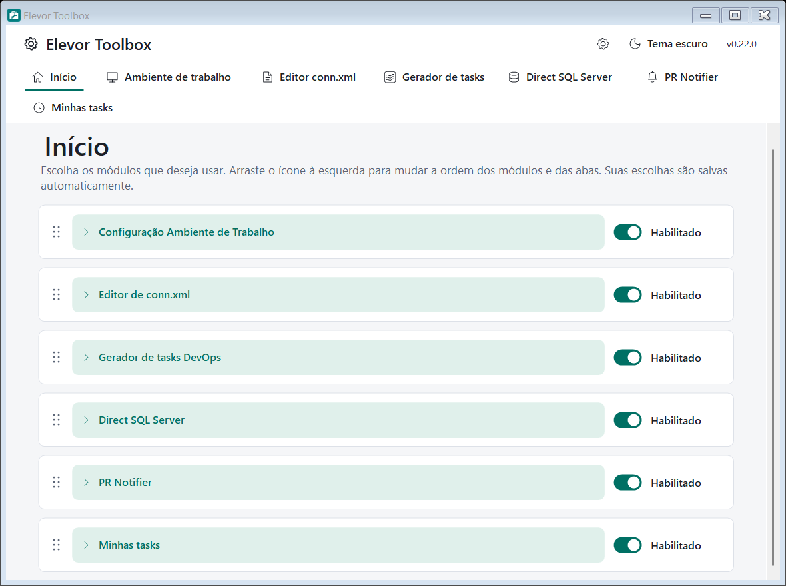

# Elevor Toolbox

Aplicativo para **Windows** que reúne, em uma só janela, as ferramentas do dia a dia de quem prepara e mantém o ambiente de trabalho do sistema Elevor: instalar e configurar o ambiente (pastas, IIS, Visual Studio, SQL Server, Git, Node.js), clonar e compilar o repositório, editar o `conn.xml`, gerar tasks no Azure DevOps, restaurar backups e acompanhar Pull Requests.

  

> **Versão atual: 0.22.9.** Veja o que mudou no [CHANGELOG](CHANGELOG.md).

## Sumário

- [Download e instalação](#download-e-instalação)
- [Requisitos](#requisitos)
- [Primeiros passos](#primeiros-passos)
- [Módulos](#módulos)
- [Documentação](#documentação)
- [Atualizações automáticas](#atualizações-automáticas)
- [Segurança e privacidade](#segurança-e-privacidade)
- [Onde ficam seus dados](#onde-ficam-seus-dados)
- [Desinstalar](#desinstalar)
- [Limitações conhecidas](#limitações-conhecidas)

## Download e instalação

1. Abra a página de [**Releases**](../../releases/latest) deste repositório.
2. Baixe o arquivo **`ElevorToolbox-win-Setup.exe`** e execute.
3. A instalação é **por usuário** (em `%LocalAppData%\ElevorToolbox`): não precisa de administrador e cria atalhos no Menu Iniciar e na Área de Trabalho. Se faltar, o instalador também instala o .NET 9 Desktop Runtime.

Os demais arquivos da release (`.nupkg`, `RELEASES`, `releases.win.json`) são usados pelo atualizador automático e **não precisam ser baixados**. O `ElevorToolbox-win-Portable.zip` é uma versão sem instalação; ela **não** recebe atualizações automáticas.

> O instalador ainda não é assinado digitalmente. Na primeira execução o Windows pode mostrar o aviso do **SmartScreen**: clique em *Mais informações* e depois em *Executar assim mesmo*.

## Requisitos

- Windows 10 ou 11, 64 bits.
- .NET 9 Desktop Runtime (instalado pelo Setup quando necessário).
- Acesso à internet para baixar instaladores e verificar atualizações.
- Para as etapas do **Ambiente de trabalho**: executar o Toolbox **como administrador** (faixa no topo com o botão *Reabrir como administrador*).
- Para os módulos que usam o Azure DevOps: um **Personal Access Token (PAT)** e, para o Ambiente de trabalho, uma **conta de domínio**.

## Primeiros passos

1. **Abra o Toolbox.** Na primeira execução só a aba **Início** aparece: todos os módulos vêm **desativados**.
2. **Configure a conexão DevOps** (engrenagem do cabeçalho → aba **DevOps**): servidor HTTPS, coleção, projeto, PAT e, se for usar o Ambiente de trabalho, a conta de domínio. Veja [Conexão DevOps](docs/conexao-devops.md).
3. **Habilite os módulos** que quiser no **Início**. Os módulos que dependem do DevOps **não ativam** enquanto a conexão não estiver completa.
4. Se for instalar ferramentas, use **Reabrir como administrador** na faixa do topo.

## Módulos

| Módulo | Para que serve | Precisa de DevOps |
|---|---|---|
| [**Início**](docs/inicio-e-aparencia.md) | Habilitar, desabilitar e reordenar os módulos; tema, paleta e idioma. | Não |
| [**Ambiente de trabalho**](docs/ambiente-de-trabalho.md) | Prepara o computador: pastas, IIS, Visual Studio, SQL Server Developer e SSMS, Git, Node.js, clone e compilação do repositório, restauração da base, `conn.xml` e aplicativo no IIS. Manual (etapa a etapa) ou [automático](docs/instalacao-automatica.md). | Sim (conexão + conta de domínio) |
| [**Editor conn.xml**](docs/editor-conn-xml.md) | Abre, edita e cria o `conn.xml` criptografado, com validação, revisão e backup, e reinicia o aplicativo do ERP ao salvar. | Não |
| [**Gerador de tasks**](docs/gerador-de-tasks.md) | Cria no Azure DevOps os pares de tasks de desenvolvimento e teste de uma User Story, reaproveitando o que já existe. | Sim |
| [**Direct SQL Server**](docs/direct-sql-server.md) | Restaura backups (`.bak`, ZIP, RAR, 7z ou link) direto no SQL Server local, e executa scripts SQL e manutenção. | Não |
| [**PR Notifier**](docs/pr-notifier.md) | Avisa na bandeja sobre comentários, votos, conflitos e builds dos seus Pull Requests. | Sim |
| [**Minhas tasks**](docs/minhas-tasks.md) | Lista as suas tasks ativas, controla o tempo (play/pause), copia nomes de branch e de PR com um clique, e prepara a extensão de navegador. | Sim |
| **Sprint Health** *(em construção)* | Acompanhará as horas lançadas por pessoa, dia e task numa sprint, com capacidade e metas. Aparece no Início, mas **ainda não pode ser ativado**. | Sim |

Também há **temas claro e escuro**, paletas de cor e idioma (português e inglês) em *Aparência e idioma*. Veja [Início, módulos e aparência](docs/inicio-e-aparencia.md).

## Documentação

| Página | Conteúdo |
|---|---|
| [Início, módulos e aparência](docs/inicio-e-aparencia.md) | Ativar e ordenar módulos, tema, idioma, bandeja. |
| [Conexão DevOps](docs/conexao-devops.md) | Servidor, coleção, projeto, PAT, conta de domínio, requisitos por módulo. |
| [Ambiente de trabalho](docs/ambiente-de-trabalho.md) | Cada etapa da instalação manual, em detalhe. |
| [Instalação automática](docs/instalacao-automatica.md) | Revisar tudo e instalar em sequência. |
| [Editor conn.xml](docs/editor-conn-xml.md) | Editar e criar o `conn.xml`. |
| [Gerador de tasks](docs/gerador-de-tasks.md) | Pares de tasks de uma User Story. |
| [Direct SQL Server](docs/direct-sql-server.md) | Guia completo de restauração, scripts e manutenção. |
| [PR Notifier](docs/pr-notifier.md) | Guia completo de notificações de Pull Requests. |
| [Minhas tasks](docs/minhas-tasks.md) | Tasks ativas, controle de tempo, nomes de branch e PR, extensão do navegador. |
| [Atualizações](docs/atualizacoes.md) | Como o Toolbox se atualiza. |
| [Solução de problemas](docs/solucao-de-problemas.md) | Erros comuns e o que fazer. |
| Histórico | [Toolbox](CHANGELOG.md) · [PR Notifier](docs/changelog-pr-notifier.md) · [Direct SQL Server](docs/changelog-direct-sql-server.md) |

## Atualizações automáticas

Instalado pelo Setup, o Toolbox **verifica sozinho** se há versão nova ao abrir, sempre que a janela reaparece e a cada hora. Quando existe, o número da versão no cabeçalho vira um aviso clicável (`v0.22.9 → vX — atualizar`); ao clicar, o app confirma, baixa e reinicia já na versão nova. Detalhes em [Atualizações](docs/atualizacoes.md).

## Segurança e privacidade

- **Nenhuma senha vem embutida.** A senha do `sa` do SQL Server, a senha da conta de domínio e o PAT começam **em branco** e são digitados por você.
- O **PAT** é guardado criptografado com o **DPAPI do Windows**, vinculado ao seu usuário. A senha da conta de domínio fica no **Gerenciador de Credenciais do Windows**.
- O endereço do servidor DevOps vem **da sua conexão**; o aplicativo não traz servidor fixo.
- Mensagens de erro e logs **mascaram** senhas e tokens.
- Os instaladores são baixados apenas de fontes oficiais (Microsoft, site do Git, nodejs.org) e verificados por **assinatura digital** e/ou **SHA-256** antes de executar.
- O PR Notifier é **somente leitura**: só consulta o Azure DevOps.

## Onde ficam seus dados

| O quê | Onde |
|---|---|
| Preferências, tema e módulos | `%APPDATA%\ElevorToolbox` |
| PR Notifier (perfil e histórico) | `%APPDATA%\ElevorToolbox\pr-notifier` |
| Logs de compilação e instalação | `%LOCALAPPDATA%\ElevorToolbox\logs` |
| Aplicativo instalado | `%LOCALAPPDATA%\ElevorToolbox` |

Problemas? Veja [Solução de problemas](docs/solucao-de-problemas.md).

## Desinstalar

*Configurações do Windows → Aplicativos → Elevor Toolbox → Desinstalar*. Seus dados em `%APPDATA%\ElevorToolbox` são mantidos; apague a pasta se quiser removê-los.

## Limitações conhecidas

- O instalador não é assinado digitalmente.
- A atualização automática só funciona na versão instalada pelo **Setup**.
- A instalação do Visual Studio abre a janela do instalador da Microsoft e pode levar bastante tempo.
- O `conn.xml` não é preenchido automaticamente: o Toolbox abre o editor ao final da instalação automática, quando for o caso.
