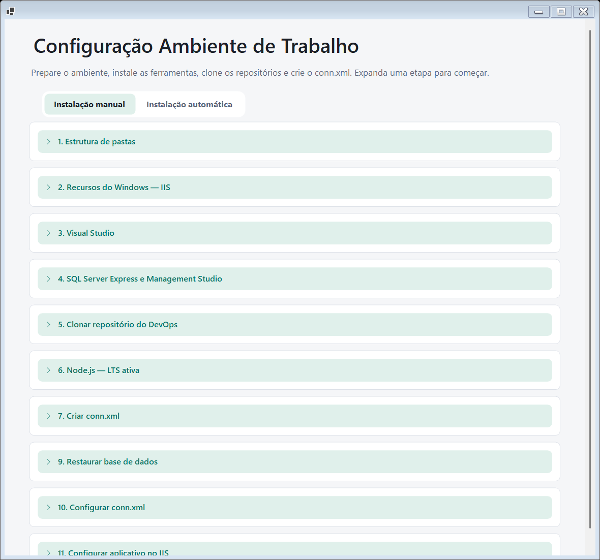
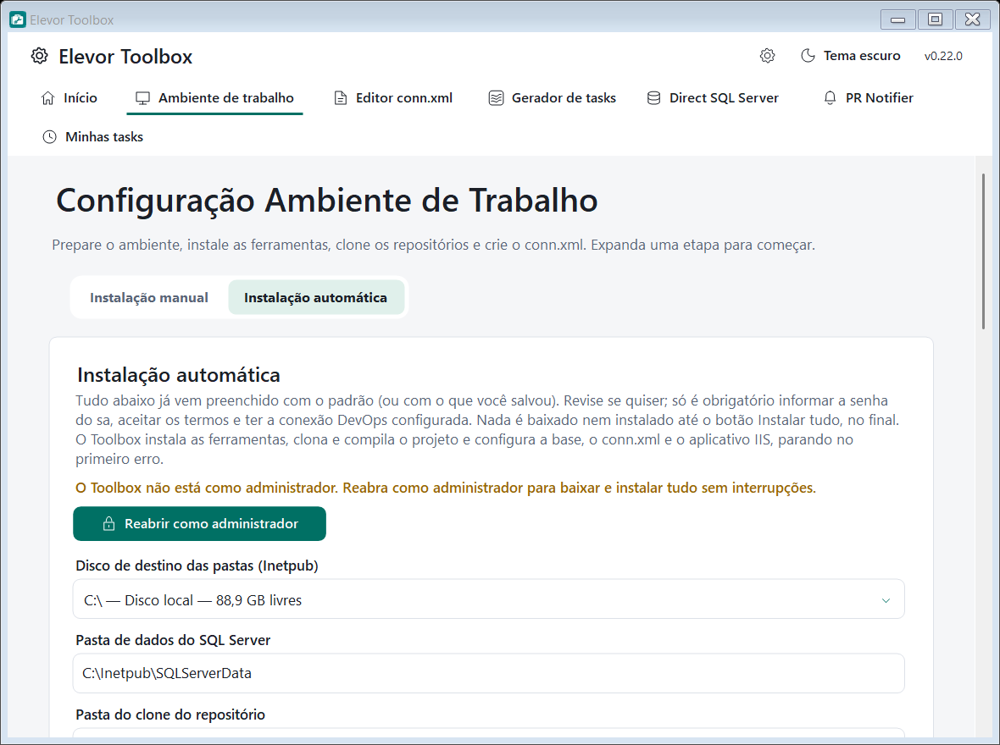

# Elevor Toolbox

Aplicativo para **Windows** que reúne, em uma só janela, as ferramentas do dia a dia de quem prepara e mantém o ambiente de trabalho do sistema Elevor: instalar e configurar o ambiente (pastas, IIS, Visual Studio, SQL Server, Git, Node.js), clonar e compilar o repositório, editar o `conn.xml`, gerar tasks no Azure DevOps, restaurar backups e acompanhar Pull Requests.

  

> **Versão atual: 0.21.3.** Veja o que mudou no [CHANGELOG](CHANGELOG.md).

## Sumário

- [Download e instalação](#download-e-instalação)
- [Requisitos](#requisitos)
- [Primeiros passos](#primeiros-passos)
- [Módulos](#módulos)
- [Instalação manual e automática do ambiente](#instalação-manual-e-automática-do-ambiente)
- [Atualizações automáticas](#atualizações-automáticas)
- [Segurança e privacidade](#segurança-e-privacidade)
- [Onde ficam seus dados](#onde-ficam-seus-dados)
- [Solução de problemas](#solução-de-problemas)
- [Desinstalar](#desinstalar)
- [Limitações conhecidas](#limitações-conhecidas)

## Download e instalação

1. Abra a página de [**Releases**](../../releases/latest) deste repositório.
2. Baixe o arquivo **`ElevorToolbox-win-Setup.exe`** e execute.
3. A instalação é **por usuário** (em `%LocalAppData%\ElevorToolbox`): não precisa de administrador e cria atalhos no Menu Iniciar e na Área de Trabalho. Se faltar, o instalador também instala o .NET 9 Desktop Runtime.

Os demais arquivos da release (`.nupkg`, `RELEASES`, `releases.win.json`) são usados pelo atualizador automático e **não precisam ser baixados**. O `ElevorToolbox-win-Portable.zip` é uma versão sem instalação; ela **não** recebe atualizações automáticas.

> O instalador ainda não é assinado digitalmente. Na primeira execução o Windows pode mostrar o aviso do **SmartScreen**: clique em *Mais informações* e depois em *Executar assim mesmo*.

## Requisitos

- Windows 10 ou 11, 64 bits.
- .NET 9 Desktop Runtime (instalado pelo Setup quando necessário).
- Acesso à internet para baixar instaladores e verificar atualizações.
- Para as etapas do **Ambiente de trabalho**: executar o Toolbox **como administrador** (o aplicativo mostra uma faixa no topo com o botão *Reabrir como administrador*).
- Para os módulos que usam o Azure DevOps: um **Personal Access Token (PAT)** e, para o Ambiente de trabalho, uma **conta de domínio**.

## Primeiros passos

1. **Abra o Toolbox.** Na primeira execução só a aba **Início** aparece: todos os módulos vêm **desativados**.
2. **Configure a conexão DevOps** (engrenagem do cabeçalho → aba **DevOps**): servidor HTTPS, coleção, projeto, PAT e, se for usar o Ambiente de trabalho, a conta de domínio. Veja [Conexão DevOps](docs/conexao-devops.md).
3. **Habilite os módulos** que quiser no **Início**. Os módulos que dependem do DevOps **não ativam** enquanto a conexão não estiver completa.
4. Se for instalar ferramentas, use **Reabrir como administrador** na faixa do topo.

## Módulos

| Módulo | Para que serve |
|---|---|
| **Início** | Habilitar, desabilitar e reordenar os módulos. |
| **Ambiente de trabalho** | Instalação **manual** (etapa a etapa) ou **automática** do ambiente: pastas, IIS, Visual Studio, SQL Server Express e SSMS, Git, Node.js, clone, compilação, restauração de base, conn.xml e aplicativo no IIS. |
| **Editor conn.xml** | Abrir, editar e criar o `conn.xml` criptografado, com validação dos campos e backup ao salvar. |
| **Gerador de tasks** | Gerar tasks no Azure DevOps a partir de modelos, conciliando com o que já existe. |
| **Direct SQL Server** | Restaurar backups (`.bak` ou arquivos compactados) direto no SQL Server local, sem etapas manuais. |
| **PR Notifier** | Avisar na bandeja do sistema sobre comentários, votos, conflitos e builds dos seus Pull Requests. |

Também há **temas claro e escuro**, paletas de cor e idioma (português e inglês) em *Aparência e idioma* (engrenagem ao lado do botão de tema).

## Instalação manual e automática do ambiente

No módulo **Ambiente de trabalho** há duas abas:

  

- **Instalação manual**: uma etapa por vez, cada uma com seus botões *Baixar*, *Configurar* e *Instalar* quando aplicável.
- **Instalação automática**: você **revisa tudo em uma única página** e, no final, clica em **Instalar tudo**. Nada é baixado nem instalado antes desse clique.

  

Detalhes, ordem das etapas e o que é obrigatório estão em [Instalação automática](docs/instalacao-automatica.md).

## Atualizações automáticas

Instalado pelo Setup, o Toolbox **verifica sozinho** se há versão nova ao iniciar, **sempre que a janela volta a aparecer** (mesmo com o app na bandeja) e a cada hora. Quando existe, o número da versão no cabeçalho vira um aviso clicável (`v0.21.0 → vX — atualizar`). Ao clicar, o app confirma, baixa a atualização e reinicia já na versão nova. O Toolbox não atualiza durante uma operação em andamento nem com alterações não salvas.

## Segurança e privacidade

- **Nenhum endereço de servidor vem embutido.** O servidor DevOps (Git, clone, listagem de repositórios e fonte NuGet) vem sempre da **conexão que você configura**; sem ela, essas funções avisam o que falta configurar.
- **Nenhuma senha vem embutida.** A senha do `sa` do SQL Server, a senha da conta de domínio e o PAT começam **em branco** e são digitados por você.
- O **PAT** é guardado criptografado com o **DPAPI do Windows**, vinculado ao seu usuário. A senha da conta de domínio fica no **Gerenciador de Credenciais do Windows**.
- Mensagens de erro e logs **mascaram** senhas e tokens.
- Os instaladores são baixados apenas de fontes oficiais (Microsoft, site do Git, nodejs.org) e verificados por **assinatura digital** e/ou **SHA-256** antes de executar.
- O PR Notifier é **somente leitura**: só consulta o Azure DevOps.

## Onde ficam seus dados

| O quê | Onde |
|---|---|
| Preferências, tema e módulos | `%APPDATA%\ElevorToolbox` |
| PR Notifier (perfil e histórico) | `%APPDATA%\ElevorToolbox\pr-notifier` |
| Logs de compilação e instalação | `%LOCALAPPDATA%\ElevorToolbox\logs` |
| Aplicativo instalado | `%LOCALAPPDATA%\ElevorToolbox` |

## Solução de problemas

- **"Sem permissão de administrador…" no topo:** use *Reabrir como administrador*. As etapas do Ambiente de trabalho precisam disso.
- **Não consigo habilitar um módulo:** ele depende da conexão DevOps (e, no Ambiente, da conta de domínio). Complete em engrenagem → **DevOps**.
- **"MSBuild não encontrado" ao compilar:** instale o Visual Studio com a carga de trabalho de desenvolvimento web/desktop (etapa 3).
- **A instalação do SQL Server falhou:** consulte `C:\Program Files\Microsoft SQL Server\<versão>\Setup Bootstrap\Log\Summary.txt`.
- **Clone falhou:** confira o PAT (*Testar PAT*) e a rede/VPN até o servidor DevOps; a mensagem mostra o último erro do Git.
- **O aviso do SmartScreen aparece:** é esperado enquanto o instalador não é assinado; veja [Download e instalação](#download-e-instalação).

## Desinstalar

*Configurações do Windows → Aplicativos → Elevor Toolbox → Desinstalar*. Seus dados em `%APPDATA%\ElevorToolbox` são mantidos; apague a pasta se quiser removê-los.

## Limitações conhecidas

- O instalador não é assinado digitalmente.
- A atualização automática só funciona na versão instalada pelo **Setup**.
- A instalação do Visual Studio abre a janela do instalador da Microsoft e pode levar bastante tempo.
- O `conn.xml` não é preenchido automaticamente: o Toolbox abre o editor ao final da instalação automática, quando for o caso.
