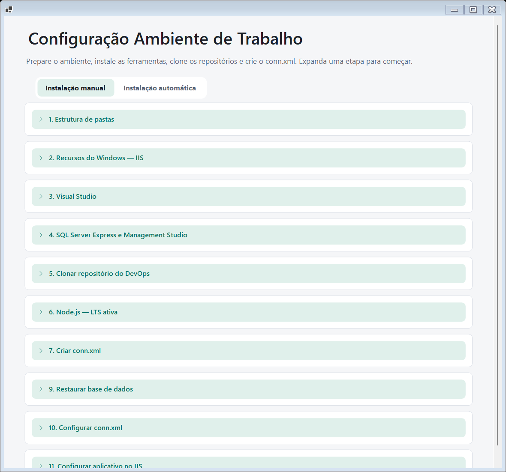

# Ambiente de trabalho

> Módulo do **Elevor Toolbox** · ver o [índice da documentação](../README.md#documentação)

Prepara um computador para trabalhar com o sistema Elevor (Ren9ve): estrutura de pastas, IIS, Visual Studio, SQL Server, Git, Node.js, clone e compilação do repositório, restauração da base, `conn.xml` e aplicativo no IIS.

O módulo tem **duas abas**:

- **Instalação manual:** uma etapa por vez, descrita nesta página.
- **Instalação automática:** você revisa tudo em uma página e executa as etapas em sequência. Veja [Instalação automática](instalacao-automatica.md).

<p align="center">
  
</p>

## Antes de começar

- Abra o Toolbox **como administrador** (faixa do topo → *Reabrir como administrador*). As etapas de instalação precisam disso.
- Para o clone e a compilação (etapa 5) e para a restauração do banco, configure a [conexão DevOps](conexao-devops.md). Para ativar o módulo é preciso a conexão completa **e** a conta de domínio.
- Cada etapa começa **fechada**; clique no título para expandir. Enquanto uma etapa executa, as demais e a aba automática ficam bloqueadas, e o Toolbox não fecha.

## 1. Estrutura de pastas

Cria a estrutura de pastas usada pelo sistema no disco escolhido.

1. Escolha o **disco de destino**. O módulo lista os discos locais prontos (fixos ou removíveis) e prefere **D:**, depois **C:**. Discos de rede e unidades ópticas não são destinos.
2. Confira a **prévia**: a árvore mostra o estado de cada pasta.
3. Clique em **Criar estrutura de pastas**.

```text
UNIDADE:\Inetpub
  SQLServerData
  wwwroot
    Ren9ve
    PortalCliente
    Smurf
```

- Pastas que já existem são **mantidas**; nada é sobrescrito nem removido. Você pode repetir a criação para completar uma estrutura parcial.
- Um arquivo no lugar de uma pasta, ou um *link* de diretório, interrompe a operação.
- Ao escolher **C:**, a etapa também dá **Controle total** ao grupo **Todos** em `C:\Inetpub` (com herança para subpastas e arquivos), sem remover as outras permissões. A prévia avisa antes.
- O módulo tenta primeiro com a permissão normal; só pede administrador (UAC) se faltar permissão.
- **Salvar disco e pastas padrão** guarda a escolha para a instalação automática.

## 2. Recursos do Windows — IIS

Liga os recursos do IIS necessários (árvore *Serviços de Informações da Internet*), usando o DISM do próprio Windows.

1. Clique em **Consultar esta máquina** (o Windows pode pedir administrador até para consultar).
2. Ajuste a árvore. Marcar um grupo marca os itens abaixo dele; um grupo parcial indica seleção parcial. **Restaurar seleção** desfaz as escolhas pendentes.
3. **Usar seleção de referência** marca a configuração recomendada (29 opções, incluindo ASP.NET e Extensibilidade .NET 4.8). Apenas seleciona; não executa nada.
4. Clique em **Revisar e aplicar**, confira o que será ativado ou desativado e confirme.

O Toolbox **nunca reinicia o Windows** sozinho e não remove os arquivos dos recursos desativados. Se o Windows exigir reinício, a etapa avisa e bloqueia novas alterações até uma nova consulta sem pendências. Em falha parcial, mostra o estado real; não há reversão automática. Desativar recursos pode afetar sites que dependem deles.

## 3. Visual Studio

Quatro abas independentes: **Baixar**, **Configurar**, **Instalar** e **Configuração final**.

- **Baixar:** escolha o **Visual Studio 2022 Enterprise** ou o **2026 Enterprise**. O Toolbox baixa o instalador oficial da Microsoft (online) com progresso e cancelamento, **sem executá-lo**. Os nomes sugeridos são `vs_enterprise_2022.exe` e `vs_enterprise_2026.exe`.
- **Configurar → Configurar opções de instalação:** escolha as **cargas de trabalho**, os **componentes individuais** (com busca), os **idiomas** (Português do Brasil e Inglês vêm marcados), as **extensões** (Microsoft RDLC Report Designer) e os **locais** de instalação, cache e componentes compartilhados. **Salvar configuração** guarda o perfil por versão; **Restaurar padrão** volta à referência. Se você nunca configurou, a instalação usa o **padrão de referência**.
- **Instalar:** selecione o `.exe` baixado (o caminho fica salvo por versão) e clique em **Instalar com a configuração salva**. A instalação pede administrador, abre o instalador da Microsoft e aguarda. Se o Visual Studio já existir, as cargas faltantes são adicionadas (*modify*). Não há reinício automático.
- **Configuração final:** depois de instalar e **fechar o IDE**, aplica ao Visual Studio instalado, nesta ordem: (1) preferências do editor, (2) a **fonte NuGet** privada, (3) a **chave de ativação** (por último). Campos de chave vazios pulam a ativação. As chaves ficam protegidas pela sua conta do Windows, separadas do perfil.

**Fonte NuGet:** com o endereço em branco (padrão), o Toolbox usa o **servidor da sua conexão DevOps** e o caminho padrão do feed. Informe um endereço HTTPS completo se o seu feed for outro. Sem conexão configurada, a etapa do NuGet é ignorada com um aviso. A fonte é gravada em `%APPDATA%\NuGet\NuGet.Config`, preservando as demais e gerando backup.

Os utilitários executados precisam ter **assinatura Microsoft válida**. Códigos 1001/1618 indicam que a Microsoft exige aguardar outra instalação terminar.

## 4. SQL Server Developer e Management Studio

Abas **Baixar**, **Configurar** e **Instalar**.

1. **Baixar:** baixa o **SQL Server Developer** (Enterprise Developer, atualmente 2025: gratuito, com todos os recursos e **sem limite de tamanho por banco**, para desenvolvimento e teste) e/ou o **Management Studio (SSMS)** nos canais estáveis atuais da Microsoft. Os links são resolvidos a cada operação; não há Evaluation nem *preview*.
2. **Configurar:** instância (padrão `MSSQLSERVER`, editável), pasta de dados e logs (por padrão `<disco>:\Inetpub\SQLServerData`), conta Windows administradora do SQL e a **senha do `sa`** com confirmação. **Não há senha padrão:** você digita a senha, que precisa ter 8 ou mais caracteres e três grupos entre maiúsculas, minúsculas, números e símbolos. Os botões de olho mostram ou ocultam cada campo.
3. **Instalar:** aceite os termos da Microsoft e clique em **Baixar e instalar selecionados**. A instalação pede administrador.

A configuração do mecanismo é fixa: português (Brasil), somente *Database Engine*, modo misto de autenticação, serviço automático e **SQL Browser desabilitado**. Instâncias existentes são detectadas e uma instalação sobre o mesmo nome é **bloqueada**; não há migração nem *upgrade* de bancos. Se o SQL exigir reinício, a instalação para antes do SSMS, que pode ser instalado depois.

Os executáveis precisam ter assinatura Microsoft válida e identificar o produto esperado. A senha do `sa` não é gravada no perfil nem enviada em argumentos; o arquivo de configuração temporário fica numa pasta protegida e é removido ao terminar.

## 5. Clonar repositório do DevOps

Abas **Baixar Git**, **Conexão e credenciais** e **Clonar repositório**.

**Git (primeira aba)** — o campo **Executável do Git** e três botões, nesta ordem:

1. **Detectar Git instalado:** procura o `git.exe`.
2. **Localizar Git:** escolher o `git.exe` manualmente.
3. **Baixar e instalar Git:** baixa o instalador x64 oficial (site do Git for Windows) e instala em modo **silencioso**, mostrando `x MB de y MB — z MB/s`.

**Clonar repositório:**

1. Configure a [conexão DevOps](conexao-devops.md). A autenticação do Git é sempre por **PAT**.
2. Escolha o repositório (**Conectar e listar repositórios**) ou informe a URL HTTPS de clone (contendo `/_git/`).
3. A pasta de destino padrão é `<disco>:\Inetpub\wwwroot\Ren9ve` (editável). Ela deve estar **vazia ou inexistente**: o módulo não faz *pull*, *reset*, exclusão nem sobrescrita.
4. Clique em **Clonar repositório**. A senha e o PAT não vão para a URL, os argumentos nem arquivos; o Git os recebe por um auxiliar temporário restrito ao servidor exato. O remoto `origin` fica com a URL limpa e os submódulos não são clonados automaticamente.

**Compilar solução:** ao lado de *Clonar*, localiza a solução (`.sln`) na pasta e a compila com o **MSBuild do Visual Studio** (restaura os pacotes e compila em *Debug*). O progresso aparece na tela e o log completo fica em `%LOCALAPPDATA%\ElevorToolbox\logs`. Sem o Visual Studio instalado, avisa que o MSBuild não foi encontrado.

## 6. Node.js — LTS ativa

Instala a versão **LTS em Active LTS** do Node.js (a linha mais recente em suporte ativo, conforme o calendário oficial de versões).

- Baixa o instalador MSI x64 do site oficial, confere o **SHA-256** e a **assinatura digital** e instala em modo silencioso (o Windows pode pedir administrador).
- Se a mesma versão já estiver instalada, não faz nada; se houver uma anterior, atualiza.
- Depois de instalar, `node` e `npm` só aparecem em terminais **novos**.

## 7. Criar conn.xml

Abre o [Editor conn.xml](editor-conn-xml.md) com o modelo padrão para você preencher e salvar criptografado. O destino padrão é a pasta `Ren9ve.ERP` do projeto clonado.

## 9. Restaurar base de dados

Restaura um backup em uma **base nova** na instância SQL local.

1. Informe o **link do ZIP** com o backup e clique em **Verificar link e listar backups**. O ZIP é lido pela rede (precisa aceitar HTTP *Range*); nada é baixado inteiro nem gravado em disco.
2. Selecione o arquivo `.bak` (se houver mais de um, a escolha é obrigatória).
3. Informe o **nome da base**. O Toolbox **sugere** o nome a partir do arquivo: em `33731_DB_ACParts_Backup_202611030230.zip` a sugestão é `ACParts`. Se o nome não seguir esse padrão, digite manualmente. O que você digitou nunca é sobrescrito.
4. Informe a instância SQL e a senha do `sa`, e clique em **Restaurar base**.

A restauração usa o motor do [Direct SQL Server](direct-sql-server.md). **Se já existir uma base com o nome escolhido, a operação é interrompida**: o Toolbox nunca substitui bases.

## 10. Configurar conn.xml

Gera o `conn.xml` do projeto já apontando para a base restaurada: servidor `localhost` e a instância informada, usuário `sa` e a senha SQL, o nome da base e o **nome da base de auditoria**. O acesso à base é conferido antes de gravar. Tags adicionais e dados de licença do arquivo existente são mantidos e é criado um backup. Esta etapa **não cria** a base de auditoria.

## 11. Configurar aplicativo no IIS

Aponta `http://localhost/Ren9ve/Ren9ve.ERP/` para a pasta do projeto, no **Default Web Site**, com o **DefaultAppPool** (CLR v4, pipeline integrado). Se houver conflito com outro projeto, a etapa é interrompida. Não move o repositório.

## Perfil das etapas 9, 10 e 11

As opções dessas etapas ficam num perfil protegido pelo Windows (DPAPI) para o seu usuário. Ele guarda a senha SQL e os links de backup, **não** guarda a conta DevOps nem o PAT, e é reaproveitado pela instalação automática.
