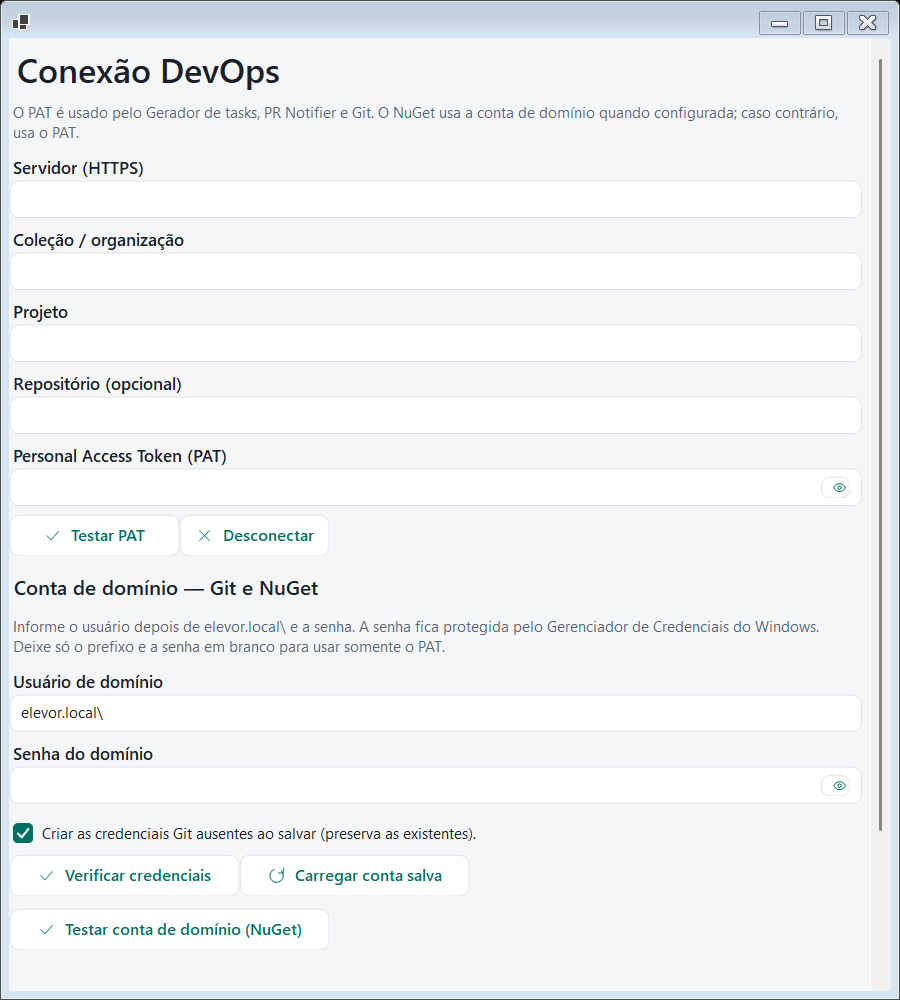

# Conexão DevOps

Usada pelo **Gerador de tasks**, pelo **PR Notifier** e pelo **Ambiente de trabalho** (clone do repositório e compilação).

Abra a **engrenagem** do cabeçalho e vá para a aba **DevOps**.

## Campos

Todos os campos começam **em branco** (a conta de domínio começa só com o prefixo `elevor.local\`).

| Campo | O que informar |
|---|---|
| **Servidor (HTTPS)** | Endereço do servidor Azure DevOps, começando com `https://`. Sem usuário, senha ou parâmetros na URL. |
| **Coleção / organização** | Coleção (Azure DevOps Server) ou organização (Services). |
| **Projeto** | Nome do projeto. |
| **Repositório (opcional)** | Repositório padrão para clonar e acompanhar. |
| **Personal Access Token (PAT)** | Token de acesso pessoal com permissão de leitura de código (e do que o módulo precisar). |

O Git usa sempre o **PAT**: não há mais escolha de autenticação.

## Fonte NuGet

Na janela de configuração do Visual Studio (*Configuração final*), o **endereço da fonte NuGet** pode ficar em branco: nesse caso o Toolbox usa o **servidor da sua conexão** e o caminho padrão do feed. Informe um endereço completo se o seu feed for outro. Sem conexão configurada, a etapa do NuGet é ignorada com um aviso.

## Conta de domínio (Git e NuGet)

- Informe o usuário depois de `elevor.local\` (por exemplo `elevor.local\usuario`) e a senha.
- Deixe só o prefixo e a senha em branco para usar **somente o PAT** (o NuGet usa o PAT quando não há conta de domínio).
- A senha fica no **Gerenciador de Credenciais do Windows**, nunca no arquivo de preferências.

## Botões

- **Testar PAT:** confirma o acesso ao projeto com o PAT informado.
- **Desconectar:** limpa a conexão e volta aos campos em branco.
- **Verificar credenciais / Carregar conta salva:** conferem e carregam a conta de domínio guardada no Windows.
- **Testar conta de domínio (NuGet):** valida a conta na fonte de pacotes.
- **Importar do PR Notifier / do Gerador de tasks:** aproveitam conexões antigas, quando existirem.

## Quais módulos exigem o quê

| Módulo | Exige |
|---|---|
| Gerador de tasks | Conexão completa (servidor, coleção, projeto e PAT) |
| PR Notifier | Conexão completa |
| Ambiente de trabalho | Conexão completa **e** conta de domínio |
| Editor conn.xml, Direct SQL Server | Nada |

Se algo estiver faltando, o Toolbox **não deixa habilitar** o módulo e mostra o que configurar. Se o módulo já estava habilitado e a configuração foi apagada, ele **avisa ao abrir** e volta ao Início.
