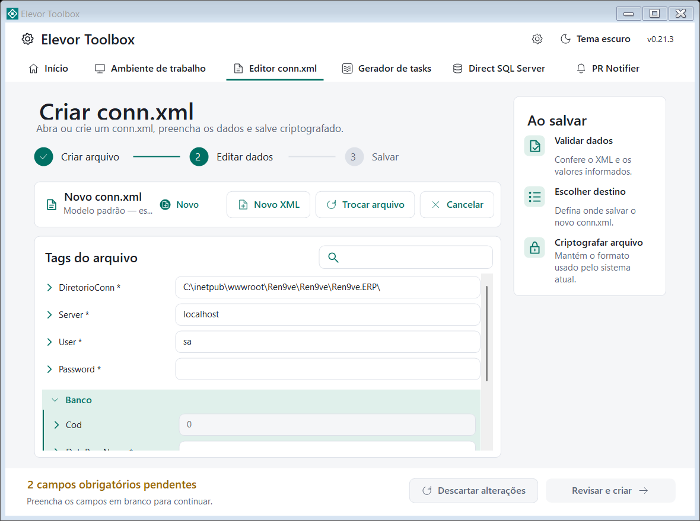

# Editor conn.xml

> Módulo do **Elevor Toolbox** · ver o [índice da documentação](../README.md#documentação)

Abre, edita e **cria** o `conn.xml` criptografado usado pelo sistema, com validação dos campos, revisão antes de salvar e backup automático.

  

Este módulo **não precisa de conexão DevOps**.

## Editar um conn.xml existente

1. Clique em **Abrir arquivo** e selecione o `conn.xml`. Também dá para **arrastar** o arquivo para a janela ou passá-lo como argumento do executável.
2. Edite os valores. Os nomes das tags e os grupos de bancos são preservados.
   - A **busca** filtra pelo **nome do campo** (contendo o texto, sem diferenciar maiúsculas/minúsculas).
   - Os títulos dos grupos recolhem e expandem.
   - `Password` e `Serial` ficam sempre visíveis; `Cod` e `CodigoCliente` aparecem desabilitados para edição.
3. Clique em **Revisar e salvar**, confira os valores e confirme **Salvar criptografado**.
4. O original é substituído de forma atômica e um **backup criptografado** é criado na mesma pasta: `conn.xml.DATA-HORA-ID.bak`.

O editor precisa de permissão de escrita na pasta (em pastas protegidas, abra com uma conta com permissão ou como administrador). Se outro programa alterar o arquivo, o salvamento é recusado até você reabri-lo. Para voltar a um backup, feche os programas que usam o arquivo, preserve a versão atual e copie o backup desejado para `conn.xml`.

## Depois de salvar: reinício do aplicativo

O ERP guarda a conexão **em memória** e só relê o `conn.xml` quando o aplicativo reinicia. Por isso, depois de salvar, o Toolbox reinicia o aplicativo do ERP para ele passar a usar o arquivo novo, e mostra o andamento na própria janela de confirmação:

- A janela **conn.xml salvo com sucesso** mostra o arquivo e o backup, e uma **barra de carregamento** com "Reiniciando o aplicativo do ERP… aguarde". O **OK** só é liberado quando o reinício termina, e a janela não fecha antes disso.
- **Como reinicia:** o Toolbox atualiza a data do `Web.config` que está na mesma pasta do `conn.xml`. Isso reinicia o aplicativo ASP.NET no **IIS** e no **IIS Express**, sem pedir administrador e sem derrubar os outros sites. O conteúdo do `Web.config` não é alterado.
- **Reserva:** se não houver `Web.config` na pasta, ou não for possível atualizá-lo, o Toolbox roda o `iisreset` (como administrador, ou pedindo a permissão do Windows). O `iisreset` **não alcança o IIS Express**: nesse caso, pare e inicie a depuração de novo.
- **Se falhar:** a janela mostra o motivo e pede para reiniciar o IIS (ou o IIS Express) **manualmente** para o ERP ler o novo arquivo. O `conn.xml` já está salvo.
- Se o IIS não estiver instalado, nada é reiniciado e nenhum aviso é mostrado.

> O reinício pelo `Web.config` mantém a depuração do Visual Studio anexada (o processo do IIS Express continua o mesmo). Se mesmo assim o `conn.aspx` continuar mostrando o nome antigo da base, veja [Solução de problemas](solucao-de-problemas.md#editor-connxml).

## Criar um conn.xml novo

1. Clique em **Novo XML** (ou, em *Ambiente de trabalho → 7. Criar conn.xml*, **Preencher conn.xml**). O Toolbox carrega a estrutura e os valores padrão do modelo embarcado, com o **nome da base e a senha em branco**: a senha é sempre digitada por você.
2. **Todos os campos são obrigatórios.** Os editáveis trazem `*`. O rodapé mostra quantos campos ainda faltam ("2 campos obrigatórios pendentes") e muda para **Todos os campos preenchidos** ao completar.
3. **Revisar e criar** só habilita com tudo preenchido. A revisão lista todos os campos do novo arquivo.
4. Escolha o destino em **Salvar novo conn.xml**. Se a pasta `Ren9ve.ERP` do projeto existir no disco padrão, ela é sugerida. Substituir um arquivo existente pede confirmação e gera backup. Cancelar preserva o rascunho.

**Cancelar** (ao lado de *Trocar arquivo*) encerra a edição ou criação atual, pedindo confirmação se houver alterações. **Descartar alterações** só restaura os valores carregados, mantendo o arquivo aberto.

## Segurança

- Os valores descriptografados ficam **somente na memória**; não há conexão com SQL Server, envio externo nem registro de credenciais em log.
- O arquivo é salvo no mesmo formato criptografado que o sistema usa; abrir o Toolbox não altera a configuração do sistema.
