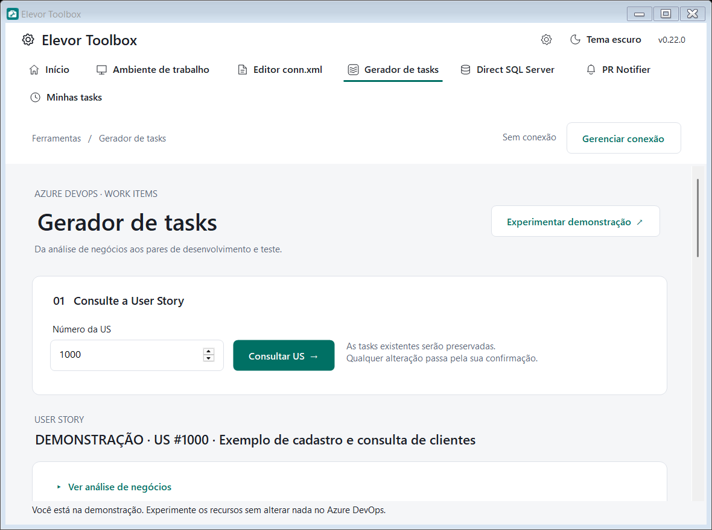

# Gerador de tasks

> Módulo do **Elevor Toolbox** · ver o [índice da documentação](../README.md#documentação)

Gera, no Azure DevOps, os **pares de tasks de desenvolvimento e teste** de uma User Story (US): consulta a US, analisa as tasks que já existem, renomeia o que precisa e cria só o que falta, sempre mostrando uma **prévia** e pedindo **confirmação** antes de gravar.

  

## Como ativar e conectar

1. No **Início**, ative **Gerador de tasks**. Ele só ativa com a **conexão DevOps** completa.
2. A conexão é a **compartilhada** (engrenagem → aba **DevOps**, veja [Conexão DevOps](conexao-devops.md)). O PAT precisa da permissão **Work Items (Read & write)**.
3. **Experimentar demonstração** permite praticar sem conexão e **sem gravar nada**.

## Fluxo

1. **Consulte a US** pelo número. A consulta não altera nada.
2. **Confira a análise** e edite os nomes das tasks existentes, se quiser.
3. Defina os **pares**: títulos como `Task 1 - Cadastro` geram sugestões de pares; você também pode informar o nome comum de desenvolvimento/teste e adicionar ou remover pares.
4. Escolha as **tasks de origem** (duas, de tipos diferentes). Elas podem ser renomeadas para o par 1; as demais são **copiadas**.
5. Opções de cópia: **links**, **anexos** e **filhos diretos** (opcionais). **Manter tempos** preserva *Planning Poker*, *Original Estimate* e *Remaining*; desmarcado zera. O *Completed* é sempre zero nas cópias novas.
6. Desmarcar **Manter informações** exige **templates** válidos de Desenvolvimento e Teste da equipe.
7. A **prévia** mostra os campos finais e só é aplicada após **confirmação explícita**. Ela expira em dez minutos. Não há *rollback* em caso de execução parcial: consulte a US de novo antes de repetir.

## Reaproveitamento de tasks existentes

O Gerador associa as tasks existentes aos pares da análise pelo **título final**, pelo **tipo** (Desenv/Dev e Teste/Testes/QA) e pela **numeração**:

- Sugere **renomear** apenas os nomes diferentes e cria somente os pares **faltantes** de cada tipo. Com 3 pares previstos: 3 dev + 3 QA geram só renomeações; 3 dev + 2 QA criam apenas a QA que falta.
- Os campos de modelo e as opções de cópia só aparecem quando há criação. Se faltar só a QA, pede só o modelo de QA. Se os nomes já estão certos, avisa que **nenhuma alteração é necessária**.
- **Numerações duplicadas**, várias tasks sem número ou **tipo não identificado** impedem associações incertas: nada é criado até os títulos serem esclarecidos.
- Tasks **excedentes** são preservadas com aviso; **nada é excluído**.
- Tasks de **UX** (título com a palavra **UX**, como `UX: Protótipo da tela` ou `UI/UX - revisão`) que não sejam de desenvolvimento nem de teste são **desconsideradas**: não entram na associação, não bloqueiam a criação dos pares e não são alteradas. Um aviso informa quantas foram ignoradas. Qualquer outra task sem tipo identificado continua bloqueando, para evitar associações incertas.

## Dados e segurança

- Os dados do módulo ficam em `%APPDATA%\ElevorToolbox\devops-tasks`. O PAT só é guardado, protegido pelo Windows (DPAPI), se você marcar **Lembrar a conexão**.
- O módulo só conversa com o seu servidor Azure DevOps. O tema e o idioma seguem a configuração global do Toolbox.
- O preenchimento da tela é mantido ao trocar de aba.
