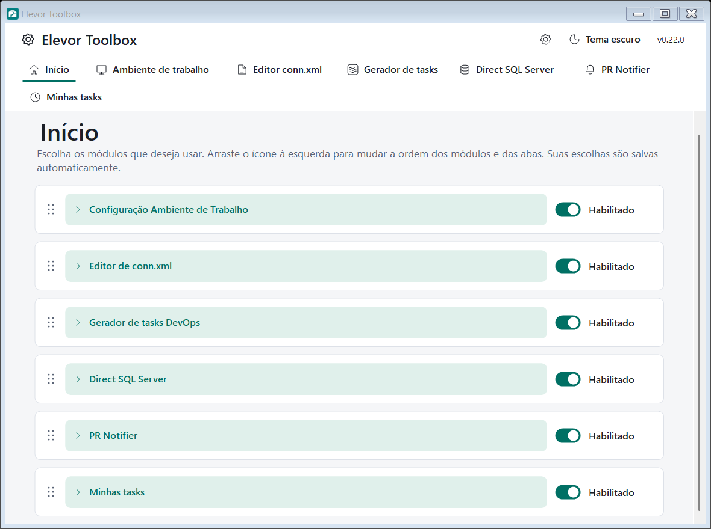

# Início, módulos e aparência

> ver o [índice da documentação](../README.md#documentação)

  

## Início e módulos

O Toolbox abre na aba **Início**, com um cartão para cada módulo. **Em uma instalação nova todos os módulos vêm desativados**: só o Início aparece, e você ativa o que quiser com o controle **Habilitado/Desabilitado** de cada cartão.

- **Habilitar** mostra a aba do módulo no topo; **desabilitar** a oculta. Os cartões continuam no Início para permitir reativar. O Início nunca some.
- As escolhas são salvas automaticamente por usuário e restauradas ao abrir. Se a gravação falhar, a opção anterior é mantida.
- **Operações em andamento** precisam terminar antes de desabilitar um módulo ou fechar o Toolbox. Desabilitar preserva configurações e rascunhos da sessão.
- Os módulos **Gerador de tasks**, **PR Notifier**, **Minhas tasks** e **Ambiente de trabalho** dependem da [conexão DevOps](conexao-devops.md): sem ela **não ativam**, e, se a configuração for apagada depois, o Toolbox **avisa ao abrir** o módulo.
- **Módulos em construção** aparecem no Início com a marca **Em construção**, o controle mostra **Indisponível** e não dá para ativá-los nem abri-los. Hoje é o caso do **Sprint Health** (horas lançadas por pessoa, dia e task, com capacidade e metas). Mesmo que uma configuração antiga o tenha deixado ligado, ele continua desativado.
- A etapa de criação do `conn.xml` no Ambiente usa o módulo **Editor conn.xml**; se ele estiver desabilitado, a etapa pede para habilitá-lo.

### Ordenar módulos e abas

No Início, **arraste a alça de seis pontos** à esquerda do cartão e solte na posição desejada; a ordem é aplicada na hora às abas do topo e salva. Pelo teclado, foque a alça e use **Alt + ↑ / Alt + ↓**. Módulos desabilitados mantêm sua posição.

## Aparência e idioma

A **engrenagem** ao lado do botão de tema abre **Aparência e idioma**:

- **Paleta:** **Verde**, **Azul** ou **Personalizado** (escolha a cor primária e a secundária; o contraste dos textos é ajustado sozinho e o fundo define claro/escuro).
- **Modo:** nas paletas Verde e Azul, o botão **Tema escuro / Tema claro** alterna direto.
- **Idioma:** Português ou Inglês. A tradução afeta os textos da interface; nomes de tags XML, SQL, valores digitados, títulos de tasks e identificadores de componentes são preservados.

Salvar aplica na hora ao Toolbox e a todos os módulos, sem perder campos preenchidos. As preferências ficam em `%APPDATA%\ElevorToolbox`.

## Bandeja do sistema

Com o módulo **PR Notifier** habilitado, **fechar a janela mantém o Toolbox na bandeja** (menu com os PRs ativos, verificação imediata, pausas e testes). **Sair** no menu encerra tudo. Desabilitar o módulo retira o ícone. Veja [PR Notifier](pr-notifier.md).

## Tamanho e posição da janela

O tamanho e o estado maximizado são restaurados ao reabrir, considerando a escala do Windows e a área disponível do monitor.
