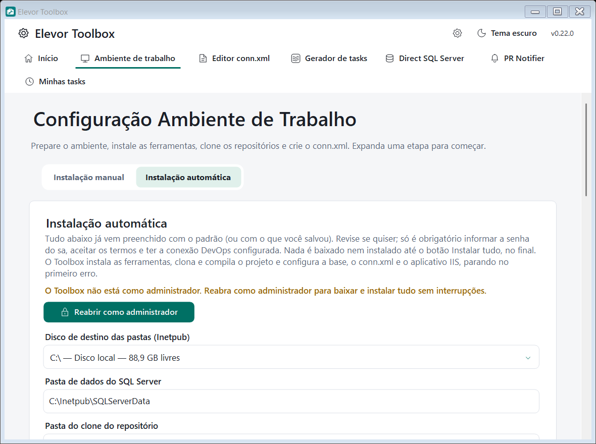

# Instalação automática

Aba **Instalação automática** do módulo **Ambiente de trabalho**. Você revisa a configuração em uma página e, no fim, inicia tudo com **Instalar tudo**.

## Antes de começar

- Abra o Toolbox **como administrador** (use *Reabrir como administrador* na faixa do topo).
- Configure a [conexão DevOps](conexao-devops.md), inclusive a **conta de domínio**.
- Tenha acesso à internet (e à VPN, se o servidor DevOps for interno).

## O que é obrigatório

Quase tudo já vem **preenchido com o padrão** ou com o último valor que você salvou. Só é obrigatório:

1. **Senha do `sa`** do SQL Server (e a confirmação), digitada por você.
2. **Aceitar os termos de licença** (SQL Server, Management Studio e Visual Studio).
3. **Conexão DevOps completa** e **conta de domínio** configuradas.

A lista **Pendências**, acima do botão, mostra exatamente o que falta; o botão **Instalar tudo** só habilita quando não há pendências.

## O que você pode revisar

- **Disco e pastas:** disco das pastas padrão (`<disco>:\Inetpub`), pasta de dados do SQL, pasta do clone, pasta do Git e do Node.js.
- **Visual Studio:** versão (2022 ou 2026). Se você nunca configurou, será usada a **configuração padrão**; o botão *Revisar configuração do Visual Studio…* abre as opções (cargas de trabalho, componentes, idiomas, pastas) só se quiser mudar.
- **SQL Server:** instância, conta Windows administradora e senha do `sa`.
- **Repositório:** nome do repositório DevOps a clonar.
- **Restauração de base (opcional):** link do ZIP com o backup, arquivo `.bak`, nome da base (sugerido pelo nome do arquivo, por exemplo `33731_DB_ACParts_Backup_202611030230.zip` → `ACParts`) e nome da base de auditoria (padrão `auditoria`).

## Ordem das etapas

1. Estrutura de pastas
2. Recursos do Windows — IIS
3. Visual Studio
4. SQL Server Developer e Management Studio
5. Git
6. Node.js (LTS ativa)
7. Clonar repositório do DevOps
8. Compilar solução
9. Restaurar base de dados (se marcado)
10. Configurar `conn.xml` (se marcado)
11. Configurar aplicativo no IIS (se marcado)

O que **já existe é pulado** (por exemplo, Git já instalado, repositório já clonado, instância SQL existente).

## Durante a execução

- Barra de progresso geral, etapa atual, mensagem (com `x MB de y MB — z MB/s` nos downloads) e **tempo decorrido** total e da etapa.
- A lista de etapas mostra ● em andamento, ✓ concluída, – pulada e ✕ falhou.
- A execução **para no primeiro erro** e mostra o motivo. Corrija e use **Voltar à revisão** para tentar de novo; o que já foi feito é pulado.
- O **reinício do Windows** só é pedido no final, se algo precisar.
- Enquanto roda, a aba **Instalação manual** fica bloqueada.

## Dicas

- A instalação do **Visual Studio** abre a janela do instalador da Microsoft e demora; acompanhe também por ela.
- Os logs de compilação ficam em `%LOCALAPPDATA%\ElevorToolbox\logs`.
- Se uma etapa falhar, você também pode rodá-la isoladamente na aba **Instalação manual**.
