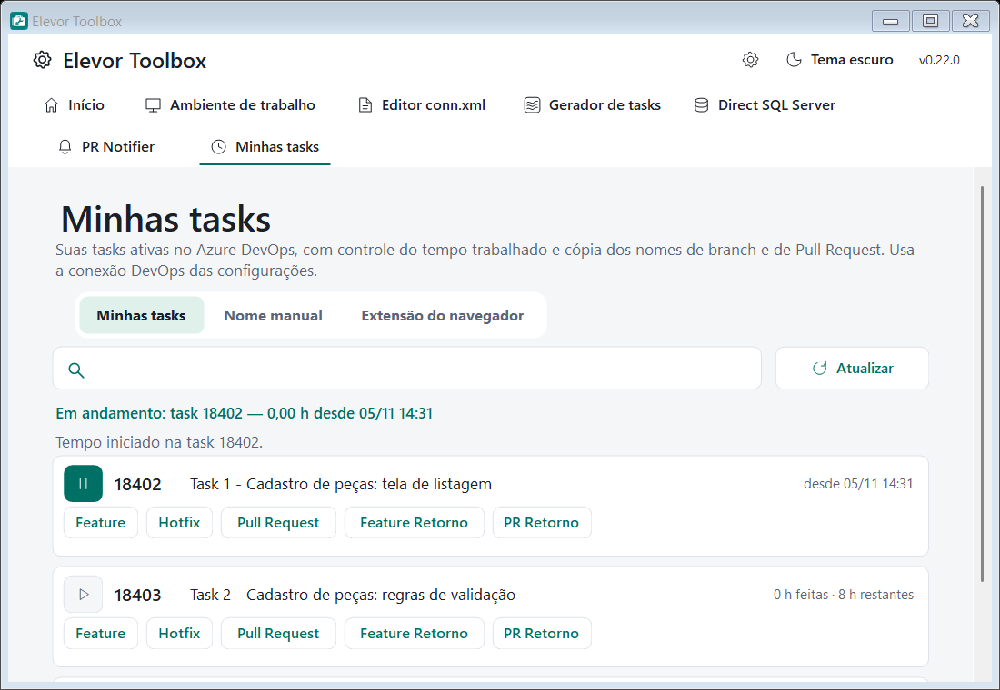
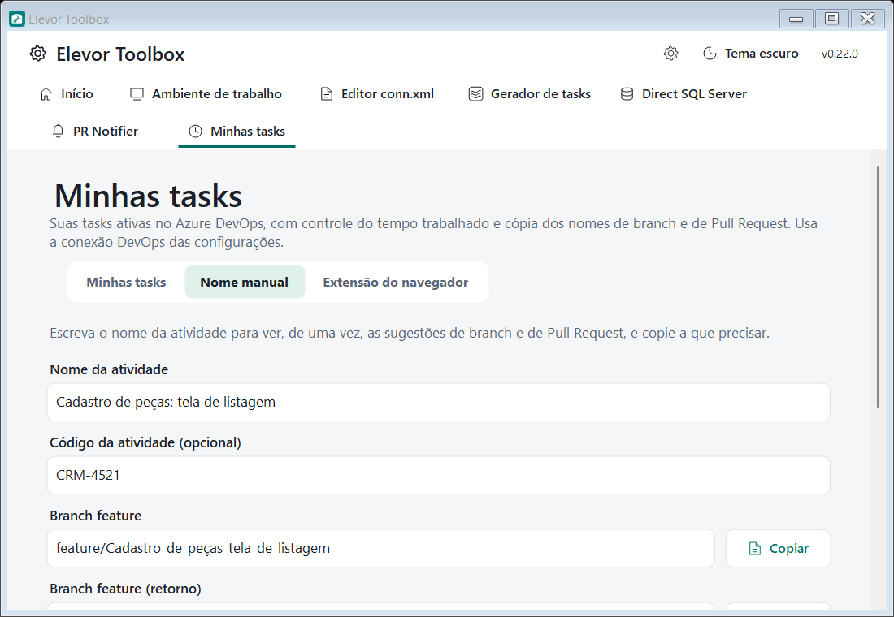
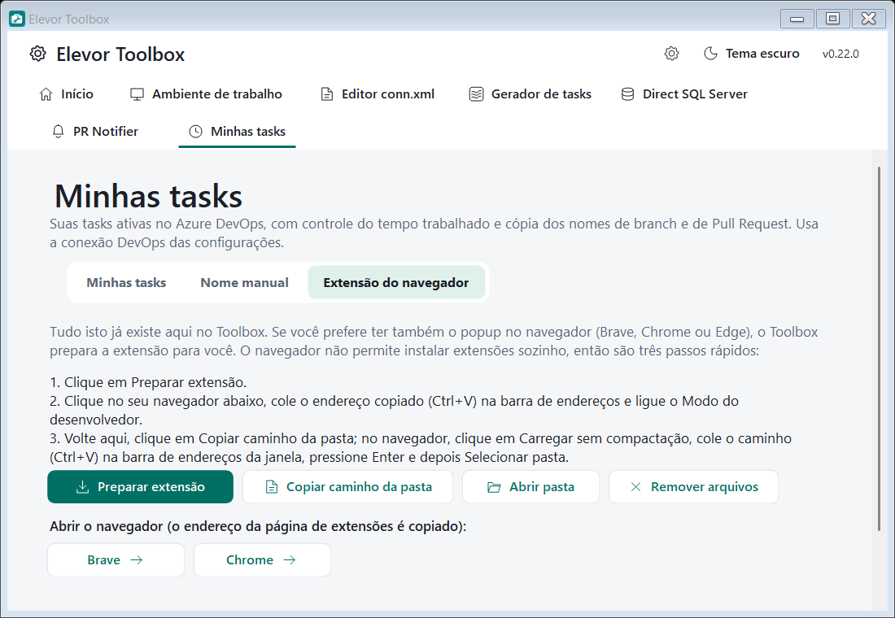

# Minhas tasks

> Módulo do **Elevor Toolbox** · ver o [índice da documentação](../README.md#documentação)

Mostra as **suas tasks ativas** do Azure DevOps, controla o **tempo trabalhado** com um play/pause e **copia com um clique** os nomes de branch e de Pull Request. Reúne, dentro do Toolbox, o que a antiga extensão de navegador "Elevor Devops" fazia, e ainda permite instalar essa extensão se você preferir o popup no navegador.

  

## Como ativar e conectar

1. No **Início**, ative **Minhas tasks**. O módulo só ativa com a [conexão DevOps](conexao-devops.md) completa.
2. Não há campos próprios para preencher: o módulo usa o **servidor, a coleção e o PAT** da conexão compartilhada. O seu usuário é reconhecido pelo próprio DevOps (`@Me`), sem digitar nome nem domínio.
3. O PAT precisa da permissão **Work Items (Read & write)**: a leitura lista as tasks e a escrita lança as horas.

O módulo é a aba **Minhas tasks** (ícone de relógio). Ela tem três sub-abas: **Minhas tasks**, **Nome manual** e **Extensão do navegador**.

## Aba "Minhas tasks"

Ao abrir pela primeira vez, o módulo consulta o DevOps e lista as tasks **ativas** atribuídas a você. **Atualizar** consulta de novo; a **busca** filtra pelo título ou pelo número.

Cada task aparece em um cartão com:

| Item | O que faz |
|---|---|
| **Play / Pause** (ícone à esquerda) | Inicia ou pausa o tempo daquela task. Só uma task roda por vez: enquanto uma estiver em andamento, os outros botões de play ficam desabilitados. |
| **Número, título e horas** | Mostra as horas já feitas e as restantes. Na task em andamento, mostra desde quando ela está correndo. |
| **Feature**, **Hotfix**, **Pull Request**, **Feature Retorno**, **PR Retorno** | Copiam o nome sugerido para a área de transferência, prontos para colar. |

### Controle de tempo

- Ao **iniciar**, o Toolbox guarda o horário de início em disco (`%APPDATA%\ElevorToolbox\my-tasks-timer.json`). Você pode **fechar o Toolbox** e o tempo continua correndo; ao reabrir, a task em andamento continua marcada.
- Ao **pausar**, o Toolbox consulta a task no DevOps, **soma** o tempo decorrido em *Completed Work* e **subtrai** de *Remaining Work* (nunca abaixo de zero), com duas casas decimais, e grava as duas horas na task.
- Em task **Closed**, só o *Completed Work* é gravado (o DevOps recusa alterar o *Remaining Work* nesse estado).
- Se a gravação **falhar** (por exemplo, sem rede), o tempo **continua correndo**: o aviso diz isso e você pode pausar de novo depois.
- Uma task em andamento que saiu da lista (por exemplo, foi fechada) continua aparecendo para que você consiga pausá-la.

### Nomes de branch e Pull Request

Os botões usam, como a extensão fazia, a **história (User Story ou Bug) a que a task pertence**:

| Botão | Exemplo |
|---|---|
| **Feature** | `feature/18390_Cadastro_de_peças` |
| **Hotfix** | `hotfix/18390_Cadastro_de_peças` |
| **Feature Retorno** | `feature/Retorno_18390_Cadastro_de_peças` |
| **Pull Request** | `CRM CRM-4521 - Cadastro de peças` |
| **PR Retorno** | `Retorno CRM CRM-4521 - Cadastro de peças` |

- **Branch:** número e título da história. Barra (`/`) vira `-`, aspas duplas viram aspas simples, espaços viram `_`, e o primeiro `:` e o primeiro `.` são removidos. Os prefixos "Bug " e "User Story " no início são ignorados.
- **Pull Request:** `CRM`, o **código da atividade** da história e o título (sem o número). Sem código, usa só `CRM` e o título.
- Se a task **não pertence a uma história** ativa, os nomes usam o título da própria task.

## Aba "Nome manual"

Para quando você quer o nome a partir de um texto que digita:

  

1. Digite o **nome da atividade** e, se quiser, o **código da atividade** (entra no título do PR).
2. As seis sugestões aparecem **de uma vez**, atualizadas a cada letra: branch feature, feature (retorno), hotfix, hotfix (retorno), título do PR e título do PR (retorno).
3. Clique em **Copiar** ao lado da que precisar.

As regras são as mesmas dos botões da aba de tasks. Se o nome começar com o número da história (`18390 Cadastro…`) e houver código da atividade, o número não entra no título do PR.

## Aba "Extensão do navegador"

Tudo o que a extensão fazia já existe nas abas acima. Se você ainda prefere o **popup no navegador** (Brave, Chrome ou Edge), o Toolbox traz a extensão embutida e a prepara para você.

  

O navegador **não permite instalar extensões sozinho** fora da loja, então são três passos:

1. Clique em **Preparar extensão**. Os arquivos são gravados em `%LocalAppData%\ElevorToolbox\browser-extension`. **Abrir pasta** abre essa pasta no Explorer.
2. Clique no seu navegador (**Brave**, **Chrome** ou **Edge**; só aparecem os instalados). Ele abre a página de extensões e o endereço (`brave://extensions`, `chrome://extensions` ou `edge://extensions`) é copiado: se abrir uma guia em branco, cole-o na barra de endereços e pressione Enter. Ligue o **Modo do desenvolvedor**.
3. Clique em **Copiar caminho da pasta**. No navegador, clique em **Carregar sem compactação**, cole o caminho na barra de endereços da janela de seleção, pressione Enter e depois **Selecionar pasta**.

Na extensão, preencha o endereço do servidor (por exemplo `https://servidor:8081`), o **PAT** e a **coleção**, os mesmos da conexão DevOps do Toolbox. O PAT da extensão fica guardado **somente no navegador**.

- **Atualizar:** quando o Toolbox traz uma versão mais nova da extensão, a aba avisa. Clique em **Preparar extensão** de novo e recarregue a extensão na página de extensões do navegador.
- **Remover:** **Remover arquivos** apaga a pasta (com confirmação, e só se ela for mesmo a extensão do Toolbox). Depois, remova também a extensão na página de extensões do navegador.
- A extensão embutida usa o usuário do próprio DevOps (`@Me`), não injeta scripts nas páginas que você visita e pede só as permissões necessárias.

## Dados e segurança

- O módulo só conversa com o **seu servidor Azure DevOps**, com o PAT da conexão compartilhada (guardado protegido pelo Windows). O PAT não vai para logs nem para mensagens de erro.
- Escreve nas tasks **apenas** os campos *Completed Work* e *Remaining Work*, e somente quando você pausa.
- O cronômetro fica em `%APPDATA%\ElevorToolbox\my-tasks-timer.json`. Apagar o arquivo descarta o tempo em andamento.

## Solução de problemas

| Sintoma | O que fazer |
|---|---|
| **"O DevOps recusou o acesso…"** | O PAT expirou ou não tem Work Items (Read & write). Gere outro em engrenagem → **DevOps**. |
| **A lista vem vazia** | O módulo lista só tasks **Active** atribuídas a você. Confira o estado e o responsável no DevOps. |
| **"O tempo continua correndo; não foi possível lançar"** | Confira a rede/VPN e clique em pausar de novo. Nada foi perdido. |
| **O botão do navegador abre uma guia em branco** | Cole na barra de endereços o endereço de extensões que foi copiado. |
| **"Falha ao carregar extensão: manifesto ausente"** | A pasta escolhida não é a da extensão. Use **Copiar caminho da pasta** e cole o caminho na janela de seleção. |
