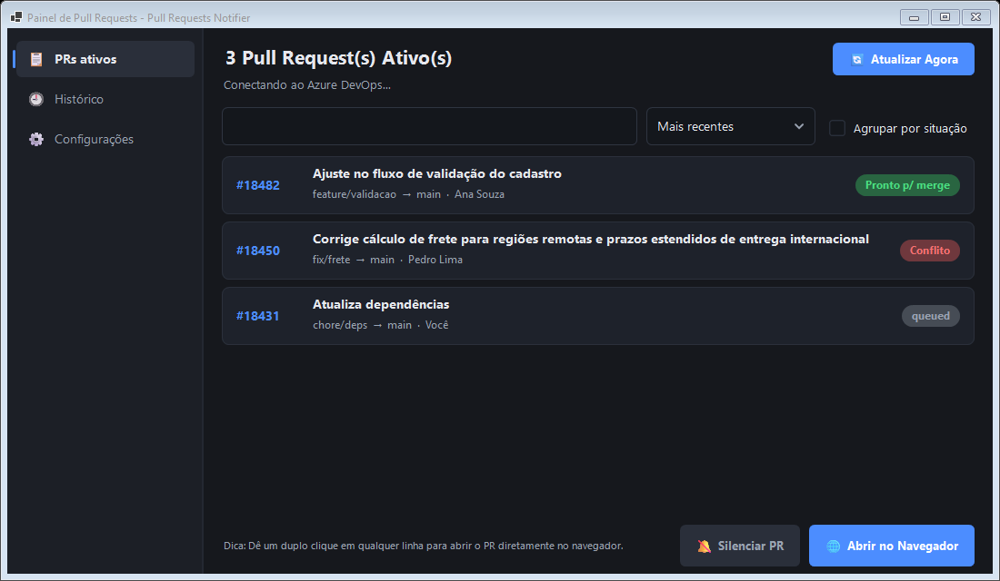
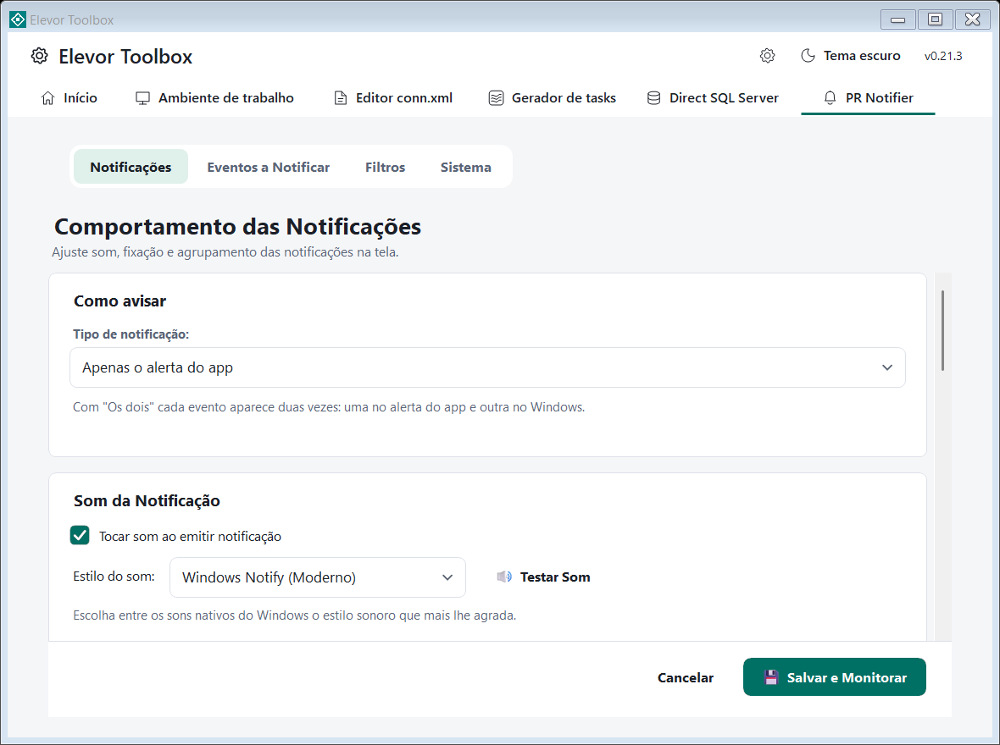
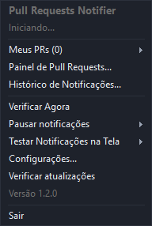
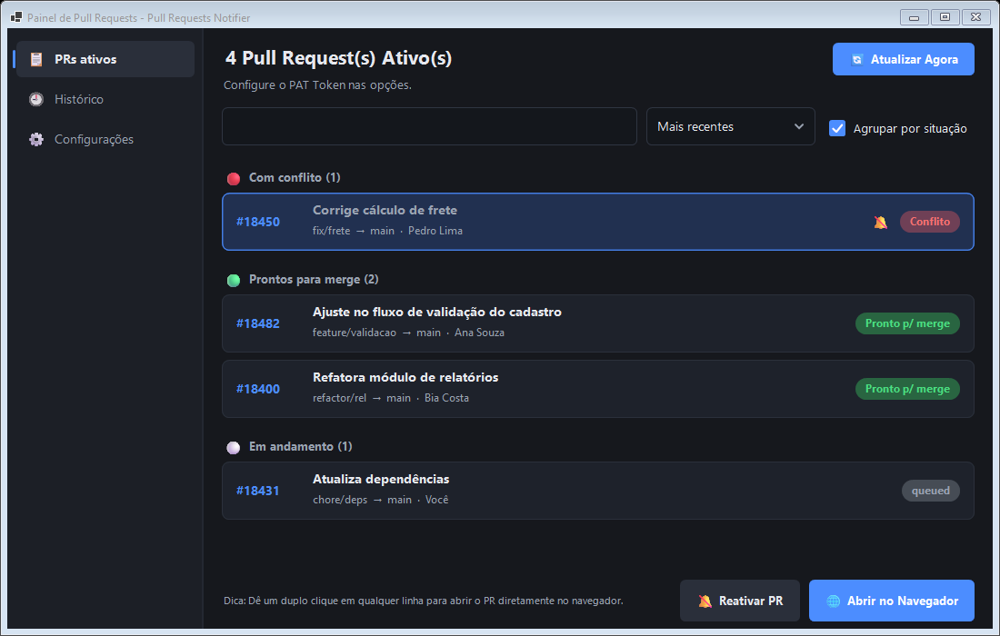
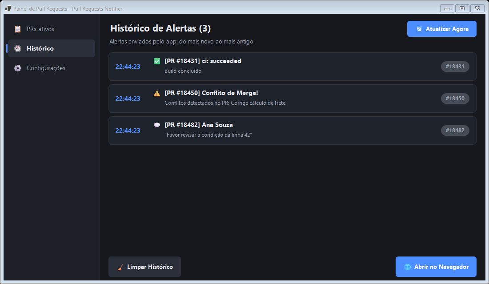
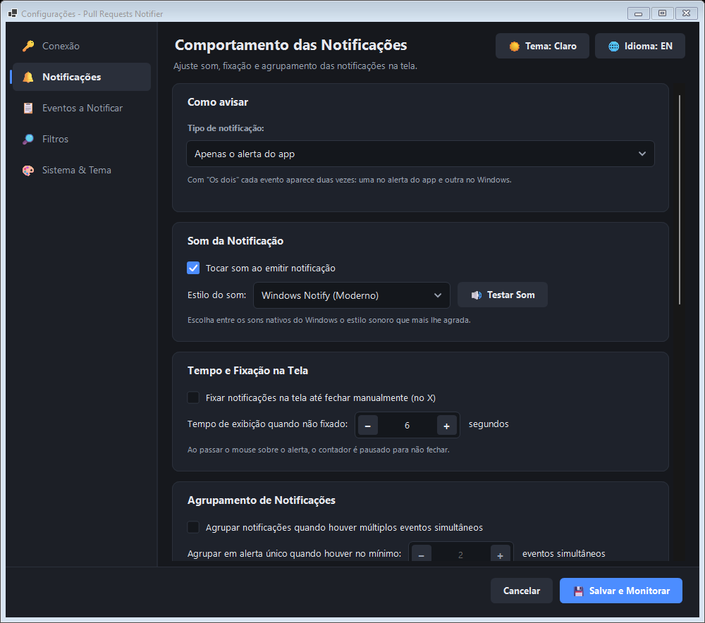
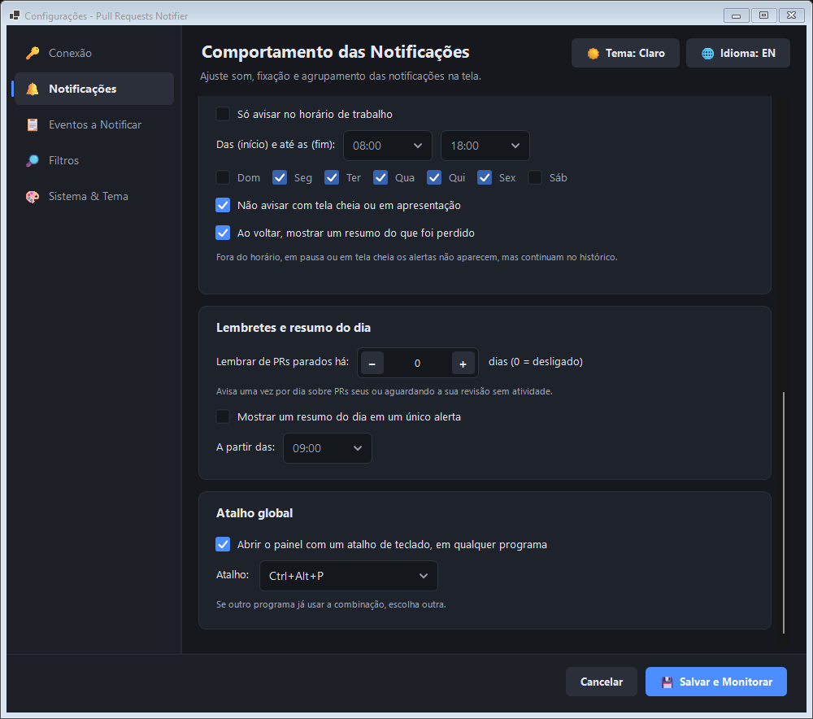
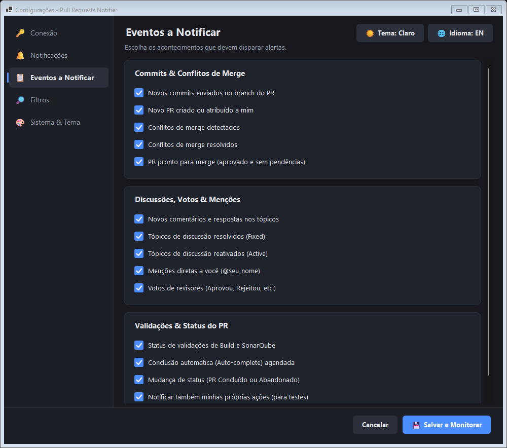
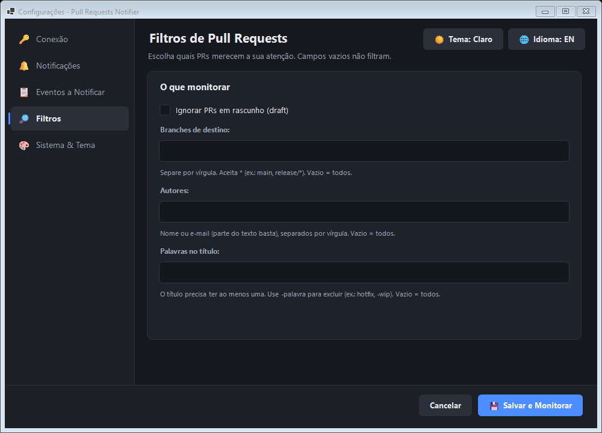

# PR Notifier

> Módulo do **Elevor Toolbox** · ver o [índice da documentação](../README.md#documentação)

Avisa na **bandeja do sistema** (perto do relógio) e na tela **na hora** em que algo acontece nos seus **Pull Requests do Azure DevOps** (Server/TFS e Services/Cloud): comentário novo, voto de revisor, conflito de merge, build que falhou, PR pronto para merge, PR concluído e mais. Você não precisa ficar com a página de PRs aberta nem atualizando o navegador: o módulo consulta o Azure DevOps de tempos em tempos, compara com o que viu antes e mostra uma notificação só do que mudou.

  

No Toolbox, o módulo é a aba **PR Notifier** (ative-a no [Início](inicio-e-aparencia.md); exige a [conexão DevOps](conexao-devops.md)):

  

> O módulo usa apenas requisições de **leitura** (`GET`) à API REST do Azure DevOps. Ele não aprova, não comenta e não altera PRs.

## Sumário

- [Como ativar e conectar](#como-ativar-e-conectar)
- [Destaques](#destaques)
- [Como funciona](#como-funciona)
- [Uso no dia a dia](#uso-no-dia-a-dia)
- [Referência de todas as opções](#referência-de-todas-as-opções)
- [Como são os alertas na tela](#como-são-os-alertas-na-tela)
- [Dados, atualização e segurança](#dados-atualização-e-segurança)
- [Solução de problemas](#solução-de-problemas)
- [Limitações conhecidas](#limitações-conhecidas)

## Como ativar e conectar

1. No **Início**, ative o módulo **PR Notifier**. Ele só ativa se a **conexão DevOps** estiver completa (servidor, coleção, projeto e PAT); caso contrário o Toolbox avisa o que falta.
2. A conexão é **compartilhada** pelo Gerador de tasks, pelo PR Notifier e pelo clone do repositório. Configure em **engrenagem do cabeçalho → aba DevOps** (veja [Conexão DevOps](conexao-devops.md)). O PAT é guardado criptografado e nunca é copiado para o perfil do módulo.
3. Abra a aba **PR Notifier**. Ajuste notificações, eventos, filtros e escopo (abas abaixo).

### Criar o Personal Access Token (PAT)

1. No Azure DevOps, clique no ícone de usuário no canto superior direito e vá em **Personal access tokens** (ou **Security → Personal access tokens**).
2. Clique em **New Token**.
3. Dê um nome (por exemplo, `Elevor Toolbox`) e escolha a validade.
4. Em **Scopes**, marque **Code → Read**. Isso basta para ler PRs, comentários e status.
5. Crie e **copie o token**: ele só é mostrado uma vez.

> Quando o token expirar, o módulo avisa "Falha de autenticação". Gere um novo e cole em *engrenagem → DevOps*.

### Dados da conexão

O endereço de um PR no navegador mostra tudo o que você precisa:

| Tipo | Endereço de um PR | Servidor | Coleção / Organização | Projeto | Repositório |
|---|---|---|---|---|---|
| **Azure DevOps Server (TFS)** | `https://devops.exemplo.com:8081/DefaultCollection/MeuProjeto/_git/MeuRepo/pullrequest/123` | `https://devops.exemplo.com:8081` | `DefaultCollection` | `MeuProjeto` | `MeuRepo` |
| **Azure DevOps Services (nuvem)** | `https://dev.azure.com/minhaorg/MeuProjeto/_git/MeuRepo/pullrequest/123` | `https://dev.azure.com` | `minhaorg` | `MeuProjeto` | `MeuRepo` |

O campo **Repositório** é opcional na conexão compartilhada: o PR Notifier lembra o repositório dos PRs que lê para montar os links.

> O módulo foi validado principalmente com **Azure DevOps Server**. A frequência de verificação e o intervalo adaptativo ficam na aba **Sistema** do módulo.

## Destaques

- **Alertas na tela** modernos, que não roubam o foco do que você está digitando, com **botões de ação**: *Abrir*, *Silenciar PR* e *Adiar 1 h*.
- **Mais de dez tipos de evento**, ligados ou desligados um a um: comentários, menções, votos, conflitos, builds, novos commits, novos PRs, PR concluído ou abandonado e outros. Mais lembrete de **PR parado** e **resumo do dia**.
- **Você escolhe como ser avisado:** só o alerta do app, só a notificação do Windows ou os dois.
- **Não perturbe:** horário de trabalho, tela cheia/apresentação e pausa pela bandeja, com um resumo do que ficou para trás.
- **Filtros:** branch de destino, autor, palavras no título e rascunhos.
- **Agrupamento inteligente** de vários eventos em um único resumo.
- **Painel de PRs** com busca, ordenação, agrupamento por situação e histórico que sobrevive ao fechamento do app.
- **Tema claro e escuro e idioma** seguem a configuração global do Toolbox.
- **Atalho global** de teclado para abrir o painel.
- **Português e Inglês**, trocáveis a qualquer momento.
- **Somente leitura:** o app só consulta o Azure DevOps, nunca altera nada nos seus PRs.
- **Atualizado junto com o Toolbox**, sem instalador separado.
- **Seguro:** o token de acesso (PAT) é guardado criptografado, vinculado ao seu usuário do Windows.
- **Acessível:** leitores de tela, foco por teclado e alto contraste.

## Como funciona

1. A cada **15 segundos** (configurável de 10 a 600) o app pergunta ao Azure DevOps quais são os Pull Requests ativos do repositório que você escolheu. O **servidor já filtra** os que você criou e/ou aqueles em que você é revisor, e a lista é **paginada**, então repositórios movimentados não ficam truncados.
2. Para cada PR, lê os comentários (tópicos), os status de validação (builds, SonarQube etc.) e os votos dos revisores, no máximo 4 consultas em paralelo.
3. Compara com o que viu na rodada anterior. **A primeira leitura depois de abrir o app serve só de referência** e não gera alertas; daí em diante, qualquer diferença vira um evento.
4. Cada evento passa pelos seus **filtros** e pelos tipos que você ligou em **Eventos a Notificar**, e entra no **histórico**. Se não estiver em silêncio (veja [Não perturbe](#não-perturbe)), vira um alerta.
5. Se um PR some da lista de ativos, o app confere se foi **concluído** ou **abandonado** e avisa.

**Intervalo adaptativo.** Sem novidades por um bom tempo, o app consulta mais devagar (até 5 minutos) e volta ao ritmo normal ao detectar algo, ao abrir o painel ou ao clicar em *Atualizar Agora*.

**Quedas de rede.** Se a VPN cair ou o servidor responder com erro, o app **não perde o que já sabia**: tenta de novo com espera crescente (até 5 minutos), mostra o estado no menu e no ícone da bandeja e avisa **uma vez** quando a conexão cai e **uma vez** quando volta. Não aparece avalanche de alertas falsos quando a conexão retorna.

> O app usa apenas requisições de **leitura** (`GET`) à API REST do Azure DevOps. Ele não aprova, não comenta e não altera PRs.

## Uso no dia a dia

Com o módulo habilitado, **fechar a janela do Toolbox mantém o aplicativo na bandeja**: o monitoramento continua. Dê duplo clique no ícone (ou use o atalho global) para reabrir. **Desabilitar** o módulo interrompe o monitoramento e retira o ícone da bandeja. Se marcar **Iniciar com o Windows**, o Toolbox abre direto na bandeja.

### O ícone da bandeja

Clique com o **botão direito** no ícone para abrir o menu. Um **duplo clique** (ou o atalho global) abre o painel de PRs.

  

| Item do menu | Para que serve |
|---|---|
| Linha de status | Mostra o que o app está fazendo: "Conectando...", "Atualizado às 14:32 (3 PRs)", "Falha ao autenticar" etc. |
| **Meus PRs (n)** | Submenu com seus PRs ativos. Clicar em um abre o PR no navegador. PRs com conflito aparecem com ⚠️. |
| **Painel de Pull Requests...** | Abre o painel com a lista completa. |
| **Histórico de Notificações...** | Abre o painel já na página do histórico. |
| **Verificar Agora** | Consulta o Azure DevOps imediatamente, sem esperar o próximo ciclo. |
| **Pausar notificações** | Silencia os alertas por 30 minutos, 1 hora, 2 horas ou até amanhã de manhã. Enquanto pausado, o item mostra "Pausado até HH:mm" e traz a opção **Retomar agora**. |
| **Testar Notificações na Tela** | Mostra um alerta individual e um alerta agrupado de exemplo, para você ver como ficam com suas configurações. |
| **Configurações...** | Abre a janela de configurações. |
| **Atualizações pelo Toolbox** | Informativo: o PR Notifier é atualizado junto com o Toolbox (veja [Atualizações](atualizacoes.md)). |
| Versão | Mostra a versão do Elevor Toolbox. |
| **Sair** | Encerra o Toolbox inteiro (respeita operações em andamento e alterações pendentes dos outros módulos). |

**O ícone muda de estado:** ganha um selo **vermelho** quando não há conexão ou o token falhou, e um selo **âmbar** quando as notificações estão em silêncio (pausa, fora do expediente ou tela cheia).

### O painel de Pull Requests

O painel tem uma **navegação** com três destinos: **PRs ativos**, **Histórico** e **Configurações**.

**PRs ativos.** Cada linha mostra o número do PR, o título, `branch de origem → branch de destino · autor` e uma **etiqueta de situação**:

| Etiqueta | Significado |
|---|---|
| 🟢 **Pronto p/ merge** | Sem conflitos de merge. |
| 🔴 **Conflito** | O PR tem conflitos que precisam ser resolvidos. |
| ⚪ outra (ex.: `queued`) | O Azure DevOps ainda está calculando o merge. |

Acima da lista há:

- **Busca:** filtra por número, título, autor ou branch enquanto você digita.
- **Ordenação:** mais recentes, mais antigos, título (A–Z), autor (A–Z) ou situação.
- **Agrupar por situação:** separa em *Com conflito*, *Prontos para merge* e *Em andamento*.

  

Um **duplo clique** (ou **Enter**) na linha abre o PR no navegador. O botão **Abrir no Navegador** faz o mesmo com a linha selecionada. **Silenciar PR** (ou **Reativar PR**) liga/desliga os alertas na tela daquele PR: ele ganha o selo 🔕 e continua aparecendo no histórico. **Atualizar Agora** (no topo) força uma consulta; se já houver uma em andamento, ele espera ela terminar.

**Histórico.** Lista os alertas que o app emitiu (os 200 mais recentes, do mais novo ao mais antigo), com horário, título, primeira linha da mensagem e o número do PR. Duplo clique abre o PR relacionado. **Limpar Histórico** esvazia a lista. O histórico é **gravado em disco** e continua disponível depois de fechar e abrir o app.

  

### Atalho global

O atalho **Ctrl+Alt+P** (configurável) abre o painel de qualquer programa. Veja [Aba Notificações](#aba-notificações).

## Referência de todas as opções

As opções ficam na aba **PR Notifier** do Toolbox. As capturas desta página vêm do aplicativo original e servem de referência: no Toolbox as telas seguem o tema global. A **conexão** (servidor, coleção, projeto, repositório e PAT) é configurada em *engrenagem → DevOps*. **Tema e idioma** seguem a configuração global de *Aparência e idioma*.

### Aba Notificações

Como e quando os alertas aparecem.

  
   
  

**Como avisar**

| Opção | O que faz | Padrão |
|---|---|---|
| **Tipo de notificação** | **Apenas o alerta do app**, **apenas a notificação do Windows** (a do ícone da bandeja, que vai para a Central de Ações) ou **os dois**. Com "os dois", cada evento aparece duas vezes. | Apenas o alerta do app |

**Som da Notificação**

| Opção | O que faz | Padrão |
|---|---|---|
| **Tocar som ao emitir notificação** | Liga/desliga o som. Quando vários alertas chegam juntos, toca um som só. | ligado |
| **Estilo do som** | Escolha entre 10 sons nativos do Windows: Windows Notify, Asterisk, Chimes, Chord, Ding, Balloon, Tada, Notify Classic, Exclamation e Beep. | Windows Notify |
| **Testar Som** | Toca o som escolhido para você ouvir. | n/a |

**Tempo e Fixação na Tela**

| Opção | O que faz | Padrão |
|---|---|---|
| **Fixar notificações na tela até fechar manualmente (no X)** | O alerta só some quando você clica no **X**. Alertas fixados ganham o selo **FIXADO**. | desligado |
| **Tempo de exibição quando não fixado** | Por quantos segundos o alerta fica visível antes de sumir (2 a 60). Fica desativado se a fixação estiver ligada. | 6 s |

> Enquanto o mouse estiver **sobre** o alerta, a contagem para e ele não fecha sozinho.

**Agrupamento de Notificações**

| Opção | O que faz | Padrão |
|---|---|---|
| **Agrupar notificações quando houver múltiplos eventos simultâneos** | Se uma mesma rodada de verificação gerar vários eventos, o app mostra **um alerta-resumo** em vez de vários. Clicar nele abre o PR (se for um só) ou a lista de PRs. Todos os eventos continuam no histórico. | desligado |
| **Agrupar em alerta único quando houver no mínimo** | A partir de quantos eventos simultâneos o resumo passa a ser usado (2 a 20). Fica desativado se o agrupamento estiver desligado. | 2 |

#### Não perturbe

| Opção | O que faz | Padrão |
|---|---|---|
| **Só avisar no horário de trabalho** | Fora do horário e dos dias escolhidos, os alertas não aparecem (continuam no histórico). | desligado |
| **Das (início) e até as (fim)** | Hora de início e de fim do expediente. Aceita janela que passa da meia-noite (ex.: 22:00 às 06:00). | 08:00 às 18:00 |
| **Dias da semana** | Dom, Seg, Ter, Qua, Qui, Sex, Sáb. | Seg a Sex |
| **Não avisar com tela cheia ou em apresentação** | Não interrompe jogos, filmes em tela cheia nem apresentações. | ligado |
| **Ao voltar, mostrar um resumo do que foi perdido** | Quando o silêncio acaba (pausa, fim de apresentação, volta do expediente), aparece **um** alerta com a quantidade de alertas que ficaram para trás. | ligado |

Além dessas regras, você pode **pausar na hora** pelo menu da bandeja ou pelo botão **Adiar 1 h** do alerta. As pausas têm prioridade sobre tudo.

#### Lembretes e resumo do dia

| Opção | O que faz | Padrão |
|---|---|---|
| **Lembrar de PRs parados há (dias)** | Avisa **uma vez por dia** sobre PRs **seus** ou **aguardando a sua revisão** (você ainda não votou) sem nenhuma atividade (comentário, push ou voto) há esse número de dias. PRs em rascunho são ignorados. `0` desliga. | 0 (desligado) |
| **Mostrar um resumo do dia em um único alerta** | Um alerta por dia, a partir da hora escolhida, com o total de PRs ativos e quantos aguardam sua revisão, têm conflito ou estão prontos para merge. Se o expediente estiver ligado, só em dias úteis. | desligado |
| **A partir das** | Hora do resumo diário. | 09:00 |

#### Atalho global

| Opção | O que faz | Padrão |
|---|---|---|
| **Abrir o painel com um atalho de teclado** | Liga o atalho global. | ligado |
| **Atalho** | Escolha entre `Ctrl+Alt+P`, `Ctrl+Shift+P`, `Ctrl+Alt+N` e `Win+Shift+P`. Se outro programa já usar a combinação, escolha outra. | Ctrl+Alt+P |

### Aba Eventos a Notificar

Escolha o que merece um alerta. **Cada caixa liga ou desliga um tipo de evento.** Por padrão, todas vêm marcadas.

  

**Commits & Conflitos de Merge**

| Opção | Quando avisa |
|---|---|
| **Novos commits enviados no branch do PR** | Alguém fez `push` no branch de origem do PR. |
| **Novo PR criado ou atribuído a mim** | Aparece um PR novo no seu escopo (criado por você ou em que você virou revisor) depois que o app já estava rodando. PRs em rascunho (*draft*) são ignorados. |
| **Conflitos de merge detectados** | O PR passou a ter conflitos. |
| **Conflitos de merge resolvidos** | O PR tinha conflitos e agora está sem eles. |
| **PR pronto para merge (aprovado e sem pendências)** | O PR tem pelo menos uma aprovação (ou aprovação com sugestões), nenhum revisor pedindo mudanças ou rejeitando, sem conflitos e sem validações falhas. Avisa **uma vez**, quando passa a estar pronto. |

**Discussões, Votos & Menções**

| Opção | Quando avisa |
|---|---|
| **Novos comentários e respostas nos tópicos** | Chega um comentário novo, inclusive resposta em um tópico que já existia. Comentários automáticos do sistema são ignorados. |
| **Tópicos de discussão resolvidos (Fixed)** | Um tópico foi marcado como resolvido. |
| **Tópicos de discussão reativados (Active)** | Um tópico resolvido foi reaberto. |
| **Menções diretas a você (@seu_nome)** | Alguém te mencionou em um comentário. Esse alerta substitui o de comentário comum. |
| **Votos de revisores (Aprovou, Rejeitou, etc.)** | Um revisor votou: *aprovou*, *aprovou com sugestões*, *está aguardando o autor* ou *rejeitou*. |

**Validações & Status do PR**

| Opção | Quando avisa |
|---|---|
| **Status de validações de Build e SonarQube** | Uma validação do PR mudou de estado (ex.: `pending` → `succeeded` ou `failed`). O ícone indica o resultado: ✅ passou, ❌ falhou, ⚙️ em andamento. |
| **Conclusão automática (Auto-complete) agendada** | Alguém agendou o *auto-complete* do PR. |
| **Mudança de status (PR Concluído ou Abandonado)** | O PR deixou de estar ativo: avisa se foi **concluído** (mesclado) ou **abandonado** e por quem. |
| **Notificar também minhas próprias ações (para testes)** | Se **desmarcada**, o app ignora o que **você mesmo** fez (seus comentários, votos, pushes, PRs e conclusões). Útil para testar o app sozinho com uma segunda conta. |

**Avisos de conexão** (sempre ativos): o app avisa quando perde a conexão com o servidor, quando o token (PAT) falha e quando a conexão volta, **um aviso por mudança de estado**.

### Aba Filtros

Escolha quais PRs merecem a sua atenção. **Campos vazios não filtram.** Os filtros valem para a lista, os alertas e os lembretes.

  

| Opção | O que faz | Padrão |
|---|---|---|
| **Ignorar PRs em rascunho (draft)** | Esconde PRs marcados como rascunho. | desligado |
| **Branches de destino** | Só PRs que vão para esses branches. Separe por vírgula e use `*` como coringa. Ex.: `main, release/*`. | vazio (todos) |
| **Autores** | Só PRs de autores cujo nome ou e-mail contenha o texto. Ex.: `ana, bia@empresa.com`. | vazio (todos) |
| **Palavras no título** | O título precisa ter **ao menos uma** das palavras. Use `-palavra` para **excluir**. Ex.: `hotfix, -wip` (só hotfix, e nunca os WIP). | vazio (todos) |

Quando mais de um filtro está preenchido, o PR precisa passar por **todos**.

### Aba Sistema

| Opção | O que faz | Padrão |
|---|---|---|
| **Intervalo de verificação em segundo plano** | De quanto em quanto tempo o módulo consulta o Azure DevOps (10 a 600 segundos). Intervalos menores avisam mais rápido, mas fazem mais requisições ao servidor. | 15 s |
| **Reduzir as consultas quando estiver ocioso (intervalo adaptativo)** | Sem novidades por um bom tempo, consulta mais devagar (no máximo a cada 5 min). Volta ao normal ao detectar algo ou ao abrir o painel. | ligado |
| **PRs onde sou revisor (Assigned to me)** | Monitora os PRs em que você foi incluído como revisor. | ligado |
| **PRs criados por mim (Author)** | Monitora os PRs que você abriu. | ligado |
| **Iniciar o Toolbox automaticamente com o Windows (na bandeja)** | Abre o Toolbox sozinho, direto na bandeja, quando você entra no Windows. Usa uma entrada própria (`ElevorToolbox.PRNotifier`). | desligado |

> Desmarcar **as duas** opções de escopo faz o módulo não monitorar nenhum PR.

## Como são os alertas na tela

- Aparecem no **canto inferior direito**, na tela onde está a barra de tarefas, com uma entrada suave (fade e deslize, se as animações do Windows estiverem ligadas), e **empilham** de baixo para cima. No máximo **4** ficam visíveis ao mesmo tempo; ao chegar o quinto, o mais antigo sai (tudo continua no histórico).
- **Não roubam o foco**: você continua digitando onde estava.
- **Botões de ação:**
  - **Abrir** (ou **Atualizar**, no aviso de nova versão): abre o PR no navegador, ou o histórico no caso de resumos de vários PRs. Clicar em qualquer ponto do alerta faz o mesmo.
  - **Silenciar PR**: para de mostrar alertas desse PR (ele continua no histórico). Para reverter, use **Reativar PR** no painel.
  - **Adiar 1 h**: silencia **todos** os alertas por uma hora.
  - **X**: só fecha o alerta.
- O mouse **sobre** o alerta pausa a contagem para fechar.
- Se você mudar a resolução ou conectar/desconectar um monitor, os alertas se reposicionam sozinhos.
- Com o tipo de notificação em **Windows** ou **os dois**, o ícone da bandeja também gera uma notificação nativa do Windows. Clicar nela faz o mesmo que clicar no alerta.

## Dados, atualização e segurança

| O quê | Onde |
|---|---|
| Opções do módulo, histórico (últimos 200 alertas) e PRs silenciados | `%APPDATA%\ElevorToolbox\pr-notifier` |
| Conexão DevOps (PAT protegido) | Configuração central do Toolbox (`%APPDATA%\ElevorToolbox`) |

- **Atualização:** o módulo é atualizado **junto com o Toolbox** (veja [Atualizações](atualizacoes.md)); não há instalador nem atualizador separado.
- O **PAT é gravado criptografado** com a proteção de dados do Windows (DPAPI), legível só pelo seu usuário do Windows nesta máquina.
- O módulo é **somente leitura** e só se comunica com o **seu servidor Azure DevOps** (e, pelo Toolbox, com o GitHub para procurar atualizações). **Não envia telemetria.**
- Use um PAT com o **menor escopo possível** (**Code → Read**) e validade curta.
- **Acessibilidade:** leitores de tela, navegação completa por teclado, alto contraste do Windows e escalas de 125%, 150% e 200%.

## Solução de problemas

**"Falha ao autenticar. Verifique URL e PAT."**
Confira: (1) a URL do servidor está só com o endereço base, sem `/_git` nem nome de projeto; (2) o nome da **coleção** (ou da organização) está certo; (3) o PAT não expirou e tem **Code → Read**; (4) você está na rede/VPN que alcança o servidor.

**"Erro de rede" / "Erro do servidor: HTTP ..." no menu da bandeja**
É um problema de conexão (VPN caída, servidor fora do ar). O app tenta de novo sozinho, com espera crescente, e **não perde** o estado anterior. Você recebe um aviso quando a conexão cai e outro quando volta.

**Cada evento aparece duas vezes (alerta do app e do Windows)**
O **Tipo de notificação** está em "Os dois". Em **Configurações → Notificações → Como avisar**, escolha **Apenas o alerta do app** (ou apenas o do Windows).

**A lista de PRs está vazia ou faltam PRs**
Verifique o **nome do repositório** (engrenagem → DevOps), se pelo menos uma opção de escopo está marcada (aba Sistema) e se algum **filtro** (aba Filtros) não está escondendo o PR. Só aparecem PRs **ativos** em que você é **autor** ou **revisor**.

**Não recebo notificações**
- Lembre que a **primeira leitura** depois de abrir o app só serve de referência: os alertas vêm das mudanças seguintes.
- Veja se o ícone da bandeja tem o selo **âmbar**: as notificações podem estar em silêncio (pausa, **fora do horário de trabalho** ou tela cheia). Os alertas continuam no histórico.
- O PR pode estar **silenciado** (selo 🔕 no painel). Use **Reativar PR**.
- Confira se o tipo de evento está marcado na aba **Eventos a Notificar** e se um filtro não o exclui.
- Se **Notificar também minhas próprias ações** estiver desmarcado, o que você mesmo faz não gera alerta.
- Use **bandeja → Testar Notificações na Tela** para ver se os alertas aparecem com as suas configurações.

**O atalho de teclado não abre o painel**
Outro programa pode já estar usando a combinação. Escolha outra em **Configurações → Notificações → Atalho global**.

**O app não abriu / diz que já está em execução**
Ele roda **uma instância por vez**. O ícone está na bandeja; clique na setinha **^** perto do relógio para ver os ícones ocultos.

**O ícone sumiu da bandeja**
Abra o Toolbox de novo pelo Menu Iniciar. Se quiser que ele abra sozinho, ligue **Iniciar com o Windows** na aba Sistema.

**Quero começar do zero**
Feche o Toolbox (bandeja → Sair) e apague a pasta `%APPDATA%\ElevorToolbox\pr-notifier`. Ao abrir de novo, o módulo volta às opções padrão.

## Limitações conhecidas

- Monitora **um repositório por vez** (o da conexão configurada).
- Funciona por **consulta periódica** (não é tempo real): o atraso máximo é o intervalo configurado (ou até 5 minutos no modo adaptativo ocioso).
- Os alertas só aparecem **enquanto o app está aberto**. Eventos que acontecem com o app fechado não são avisados depois.
- Os lembretes de PR parado recomeçam ao reabrir o app (no máximo um por dia por PR enquanto ele estiver aberto).
- Somente Windows.

> O histórico das versões do aplicativo original está em [notas de versão do PR Notifier](changelog-pr-notifier.md).
